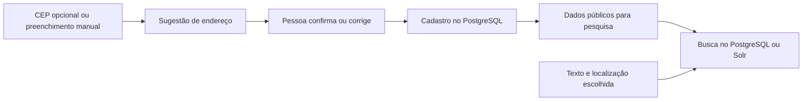

# Localização nacional e evolução da busca

Proposta para discussão, atualizada em **30/10/2026**, relacionada às issues [#158 — endereço](https://github.com/fabsreis/Negocio-do-bem/issues/158), [#139 — arquitetura](https://github.com/fabsreis/Negocio-do-bem/issues/139) e [#40 — profissionais e serviços](https://github.com/fabsreis/Negocio-do-bem/issues/40). A implementação parcial está no [PR #168, em rascunho](https://github.com/fabsreis/Negocio-do-bem/pull/168). Este documento propõe próximos passos; não declara esses recursos entregues.

## Direção proposta

**Consultar o CEP, confirmar o endereço e pesquisar por uma localização estruturada é um caminho nacional.** O DF evidencia o problema, mas a solução precisa acomodar municípios, bairros, distritos, regiões administrativas, comunidades rurais e outras localidades. O motor de busca recebe dados já organizados; sua adoção, sozinha, não corrige lugares ambíguos ou incompletos.

O fluxo proposto é:

Há três informações diferentes: endereço do negócio, preferência de localização de quem pesquisa e área onde um serviço é prestado. Um negócio situado em Recife pode atender Olinda; um profissional pode atender remotamente. Não deduzir uma dessas informações da outra.

## O que existe e o que falta

Leitura do código do PR até o commit `e46f4d7`, em 30/10/2026; isso não significa que esteja publicado na `stage` ou em produção.

| Parte | Implementado no rascunho | Ainda pendente |
| --- | --- | --- |
| Cadastro | Município/UF, bairro, localidade, região do DF e detalhes postais opcionais | Identidade territorial nacional; revisão dos rótulos e do fluxo começando pelo CEP |
| Consulta postal | ViaCEP opcional, cópia persistente, cotas e pausa compartilhadas | Aproveitar código IBGE, tratar conflitos entre município e sugestões como um conjunto, validar respostas atrasadas |
| Lugares | Municípios por nome/UF; bairros/localidades livres; lista específica do DF | Identificadores e fontes para subdivisões, aliases e migração gradual |
| Busca | Campo `Empresa.busca` normalizado, consultado com `contains`; filtros e sugestões por nomes | Índices de texto/similaridade, relevância medida e filtros por identificadores |
| Privacidade | Detalhes postais fora da busca; publicação no perfil exige autorização | Revisão da política e manutenção das mesmas garantias em qualquer novo índice |
| Localização pessoal | `Usuario` não tem endereço nem cidade de pesquisa | Decidir se a pessoa poderá salvar somente município/localidade como preferência |
| Serviços | Diretório atual pesquisa negócios, seus resumos e categorias | Catálogo de serviços, modalidade e área de atendimento pertencem à discussão da #40 |

O código atual não usa `tsvector`, `pg_trgm` ou Solr. Não foi feito benchmark de carga ou relevância nesta revisão. Os detalhes operacionais do que já existe estão em [Endereço e localização](endereco.md).

## Dados: município, território e endereço postal

O ViaCEP retorna `ibge`, `localidade`, `uf`, `bairro` e `logradouro`. No exemplo oficial, `localidade` é o município, `regiao` é a macrorregião (como Sudeste) e `complemento` pode ser uma observação postal (como lado da via). Esses nomes não podem ser copiados indiscriminadamente para os campos do aplicativo. O retorno padrão não fornece coordenadas. [Documentação do ViaCEP](https://viacep.com.br/).

A API de Localidades do IBGE oferece identificadores e relações de municípios, distritos e subdistritos. Isso permite uma referência nacional, mas não demonstra cobertura de todos os bairros, comunidades ou regiões administrativas reconhecidos localmente. [API de Localidades do IBGE](https://servicodados.ibge.gov.br/api/docs/localidades).

Modelo conceitual proposto, sujeito a revisão antes de uma migração:

| Informação | Representação proposta | Regra |
| --- | --- | --- |
| Município | Código IBGE como texto, nome oficial e UF | Identidade principal para filtrar e agrupar; conferir código, nome e UF juntos |
| Subdivisão/localidade | ID interno, tipo, nome, município associado, fonte e código externo quando existir | Não usar apenas o nome como identidade; referências IBGE e locais não são equivalentes automaticamente |
| Grafias alternativas | Aliases associados a um lugar identificado | Servem para encontrar o lugar; não fundem homônimos |
| Texto informado | Nome/localização preservados quando não houver correspondência confiável | Ausência em um catálogo não torna um endereço legítimo inválido; não criar equivalência oficial por semelhança |
| Endereço postal | CEP textual, logradouro, número e complemento opcionais | Separado da identidade do lugar e da preferência de busca do usuário |
| Proveniência | Fonte, data da consulta, versão quando disponível e confirmação/correção pela pessoa | Distinguir sugestão externa de dado confirmado; atualização da fonte não sobrescreve cadastro |

Não impor uma árvore obrigatória `município → distrito → bairro`: essas divisões nem sempre têm a mesma organização. Tipos e vínculos precisam acompanhar a fonte. Para o primeiro incremento, basta incorporar o código municipal e preservar os textos existentes; criar um catálogo nacional completo de bairros não deve ser pré-requisito do cadastro.

Para migrar dados antigos, mapear automaticamente apenas correspondências inequívocas de município/UF, registrar ambiguidades para revisão e manter compatibilidade com nomes, URLs e contagens atuais. Não chamar a API de CEP para enriquecer toda a base. Identificadores oficiais também precisam de fonte e atualização controlada quando a divisão territorial mudar.

O CEP pode representar localidades, logradouros, unidades postais, organizações ou edifícios. Portanto, não deve ser chave de município/bairro nem prova da posição exata do negócio. O tratamento do DF nos Correios é uma convenção postal específica, útil em um adaptador da fonte, sem definir o modelo de todo o país. [Guia de Endereçamento dos Correios](https://www.correios.com.br/enviar/precisa-de-ajuda/guia-de-enderecamento/guia-de-enderecamento).

**Não ampliar a regra do DF por prefixo como solução geral.** Por exemplo, transformar automaticamente “Ceilândia Norte” em uma região pode parecer conveniente, mas não estabelece um método nacional confiável. Quando não houver correspondência sustentada por fonte, preservar o texto e oferecer confirmação/seleção. Brasília/DF e Taguatinga/TO continuam distintos; regiões do DF não viram municípios artificiais.

## Experiência de cadastro e pesquisa

1. Oferecer CEP opcional no início da localização, junto da alternativa manual. Consultar no servidor, respeitando cache, cotas e indisponibilidade; mostrar a origem e eventual desatualização da sugestão.
2. Apresentar município e demais dados disponíveis para confirmação. Número, complemento pessoal e dados ausentes continuam a cargo da pessoa. Não exigir bairro/logradouro onde a fonte não os fornece.
3. Se o município já preenchido divergir, pedir uma escolha antes de aplicar qualquer parte conflitante. Hoje o formulário não preenche nada nesse caso e pede para conferir o CEP ou a cidade; falta oferecer a escolha.
4. Vincular cada resposta ao CEP ainda presente no formulário, descartar respostas atrasadas e preservar edições manuais. Trocar ou apagar o CEP durante uma consulta deve fazer parte do teste de aceitação.
5. Separar “O que procura?” da localização selecionada. A seleção de um município/localidade deve enviar seu identificador; texto livre ambíguo deve oferecer opções com município/UF. Ampliar para outras cidades deve ser uma escolha visível.
6. Se houver localização salva na conta, propor seu uso como preferência editável, com opção “Todo o Brasil”. Não é necessário guardar endereço residencial completo para filtrar por cidade. Não aplicar silenciosamente a cidade de um negócio administrado pela pessoa como sua preferência pessoal.
7. Para a #40, distinguir endereço do prestador de área de atendimento e modalidade presencial/remota. Só indexar serviços que realmente existirem no cadastro, sem inventá-los a partir do endereço.

Consulta postal e busca são operações distintas: pesquisar negócios em uma cidade não deve fazer uma chamada ao ViaCEP a cada pesquisa. A consulta postal enriquece o cadastro; a pesquisa lê os dados confirmados e autorizados.

Busca por distância fica como evolução separada. O Solr suporta filtros e ordenação espacial, mas eles exigem dados geográficos. Uma posição aproximada de CEP não pode ser apresentada como a porta do estabelecimento. Fonte, precisão e autorização de uso das coordenadas precisam ser definidas antes. [Busca espacial do Solr](https://solr.apache.org/guide/solr/latest/query-guide/spatial-search.html).

## PostgreSQL ou Apache Solr?

Apache **Solr** é um candidato válido. A decisão proposta é comparar alternativas sobre o mesmo conjunto de consultas e dados, começando por medir o que o PostgreSQL existente consegue entregar.

| Critério | Evolução no PostgreSQL | Índice externo no Solr |
| --- | --- | --- |
| Filtro de município/localidade | Colunas identificadas e índices adequados às consultas | Campos exatos para IDs/UF, separados dos campos de texto |
| Relevância textual | `tsvector`/`tsquery`, pesos e ranking; GIN para texto | eDisMax, pesos por campo e aproximação de frases |
| Grafias próximas | Avaliar `pg_trgm` junto dos filtros exatos | Avaliar configuração de análise e recursos de sugestões; calibrar erros e sinônimos no protótipo |
| Contagens por filtro | Consultas SQL sobre a mesma condição de publicação | Facetas, mantendo a semântica das contagens atuais |
| Consistência | Possibilidade de atualizar a projeção na mesma transação | Sincronização, atraso, reprocessamento e remoções precisam de desenho explícito |
| Operação | Usa a infraestrutura existente, mas aumenta trabalho e espaço do banco | Acrescenta serviço, armazenamento, monitoramento e manutenção; SolrCloud inclui ZooKeeper |

O PostgreSQL documenta [busca textual e ranking](https://www.postgresql.org/docs/16/textsearch-controls.html), [índices GIN](https://www.postgresql.org/docs/16/textsearch-indexes.html) e [similaridade com `pg_trgm`](https://www.postgresql.org/docs/16/pgtrgm.html). Essas capacidades não estão ativadas pela mera existência de `Empresa.busca`. Conferir versão/extensões do ambiente e planos com `EXPLAIN (ANALYZE, BUFFERS)` antes de escolher índices; termos curtos precisam de avaliação própria.

O Solr documenta [eDisMax](https://solr.apache.org/guide/solr/latest/query-guide/edismax-query-parser.html), [facetas](https://solr.apache.org/guide/solr/latest/query-guide/json-facet-api.html) e [modos de operação](https://solr.apache.org/guide/solr/latest/deployment-guide/cluster-types.html). A página de downloads consultada lista 10.1.0 como versão mais recente; isso é contexto da pesquisa, não escolha de versão ou compromisso de instalação. [Downloads oficiais](https://solr.apache.org/downloads.html).

Em ambas as alternativas, testar acentos, nomes próprios e termos portugueses. Análise linguística de descrições e correspondência de nomes de lugares têm objetivos diferentes: não aplicar stemming ou tolerância a erro aos IDs. Relevância também é uma mudança de produto: definir sua relação com “verificados primeiro”, atualização e ordenação alfabética, preservando a regra de não haver ranking por nota nem anúncio pago.

**Recomendação para discussão:** fazer um experimento limitado com PostgreSQL e comparar Solr se houver ganho necessário de relevância, facetas ou capacidade. Não há evidência coletada de que o diretório já exceda a capacidade do PostgreSQL, nem de que Solr se justifique apenas porque a cobertura desejada é nacional.

## Contrato de indexação e privacidade

O PostgreSQL permanece como fonte dos cadastros. Um índice de pesquisa é uma projeção reconstruível, contendo apenas os campos públicos necessários. CEP, logradouro, número e complemento permanecem fora da busca nesta proposta, inclusive quando autorizados para exibição no perfil. Autocomplete, facetas e logs também não devem recuperar campos privados por caminhos indiretos.

Se for escolhido um motor externo, a proposta exige:

- Registrar a alteração e um evento pendente na mesma transação no banco (outbox). Um processo separado envia o evento ao índice; gravação de cadastro não depende de uma chamada síncrona ao Solr.
- Processar eventos de forma idempotente por ID e versão, com retomada, tentativas limitadas e observação de falhas. Eventos antigos não podem restaurar conteúdo removido. Incluir edições, moderação, ocultação e exclusão.
- Medir atraso e reconciliar o índice com o banco. Reindexar em uma versão separada, acompanhar alterações durante a carga, validar resultados e só então trocar a versão consultada; permitir voltar à anterior quando ainda for válida.
- Preservar a regra de publicação também em resultados, sugestões e totais. Conferir só os cartões no banco não elimina vazamento pelas contagens. A primeira versão deve consultar o PostgreSQL para toda a resposta quando houver remoção/restrição ainda não aplicada ao índice; apenas voltar ao motor após confirmação. Validar a concorrência dessa transição antes de habilitar o caminho externo.
- Manter o motor acessível pelo servidor, com campos, filtros, tamanho e tempo de consulta limitados. O navegador não recebe credenciais nem envia consultas administrativas ao motor.
- Na indisponibilidade do índice, oferecer a busca disponível no PostgreSQL, com informação sobre eventual redução de recursos. Falha de infraestrutura não pode virar silenciosamente “nenhum resultado”.

No desenho modular da #139, Cadastro cuida do endereço confirmado; a integração postal traduz a fonte; Catálogo cuida do contrato da consulta e de sua projeção. Essas fronteiras podem continuar dentro do monólito. A escolha de Solr não exige separar todo o sistema em serviços.

## Etapas e verificação

| Etapa | Entrega discutida | Evidência necessária |
| --- | --- | --- |
| 1 — Concluir a base da #158 | Revisar o rascunho, consistência do CEP, configuração, privacidade, política de cache e integração com #145 | Testes dos conflitos/respostas atrasadas, falhas e concorrência; CI e preview autorizados |
| 2 — Identidade nacional | Código municipal, correspondência entre fontes e preservação dos dados antigos; definir preferência pessoal | Migração sem dedução ambígua; filtros, URLs e contagens compatíveis; casos nas cinco regiões |
| 3 — Medir a busca (#139) | Corpus de consultas, índices PostgreSQL e comparação limitada com Solr | Relatório de qualidade, latência, recursos e custo operacional |
| 4 — Adotar o resultado | Motor escolhido e garantias de atualização/remoção | Testes de recuperação, reconstrução e privacidade; critérios aprovados antes da ativação |
| 5 — Integrar serviços (#40) | Modalidade e área de atendimento no catálogo futuro | Endereço do prestador não restringe indevidamente onde ele atende |

Não condicionar toda a #158 à instalação de Solr. O escopo postal pode avançar, enquanto a identidade nacional e a evolução da busca recebem entregas próprias alinhadas às issues relacionadas.

O corpus deve usar dados fictícios com casos das cinco regiões: bairro homônimo em municípios diferentes, nomes com e sem acento, distrito, localidade rural, CEP genérico/incompleto, DF/TO, cadastro antigo e negócio oculto. Esses casos testam o modelo; não provam que um provedor tenha cobertura perfeita do país.

Antes de executar o comparativo, combinar consultas esperadas, volume, concorrência e metas. Medir acertos entre os dez primeiros resultados (precisão/recall e ordenação avaliada), buscas sem resultado, p95/p99 de latência, espaço/custo, impacto nas gravações e atraso de atualização. Usar a mesma carga e registrar índices/configurações. O filtro exato não pode trazer outra UF/município; resultado, sugestão e contagem não podem expor negócio oculto ou dado privado. Não há números de tráfego ou resultados de benchmark disponíveis nesta discussão.

## Decisões ainda abertas

- A preferência de localização pertence à conta, à sessão ou somente à URL? Proposta inicial: URL e escolha explícita; persistência pessoal opcional, sem endereço residencial completo.
- Quais fontes e tipos de subdivisão devem entrar primeiro, além do município IBGE? Como revisar uma correspondência incerta sem impedir cadastro manual?
- Quais metas de qualidade, tempo de resposta, atualização e custo justificariam um motor externo? Quem manteria essa infraestrutura?
- Qual política de armazenamento/retenção é aceita para a fonte postal? Os prazos e cotas atuais são escolhas do projeto, não limites contratados ou autorização expressa do provedor.
- Como comunicar a localização aproximada e a área de atendimento no futuro catálogo de serviços?

A API Busca CEP dos Correios é outra possibilidade de fonte, mas seu manual exige pessoa jurídica, contrato comercial habilitado e autenticação. Não há contratação proposta aqui. A fonte deve ser escolhida por cobertura observada, condições de uso e operação, mantendo o cadastro manual. [Manual oficial](https://www.correios.com.br/atendimento/developers/manuais/manual-api-busca-cep).
