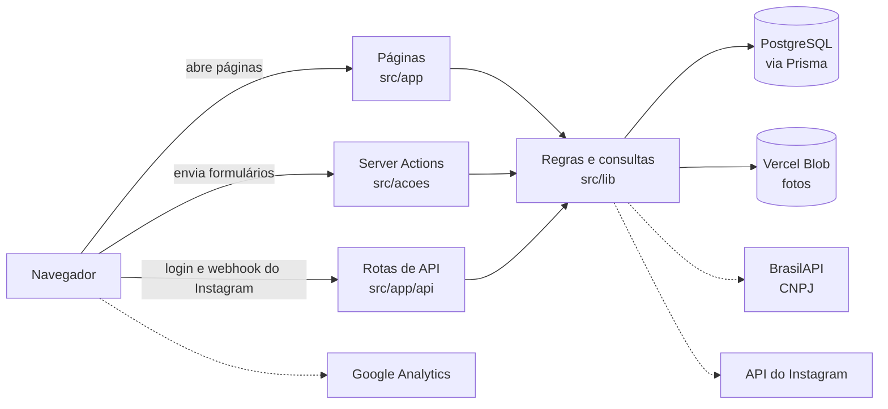
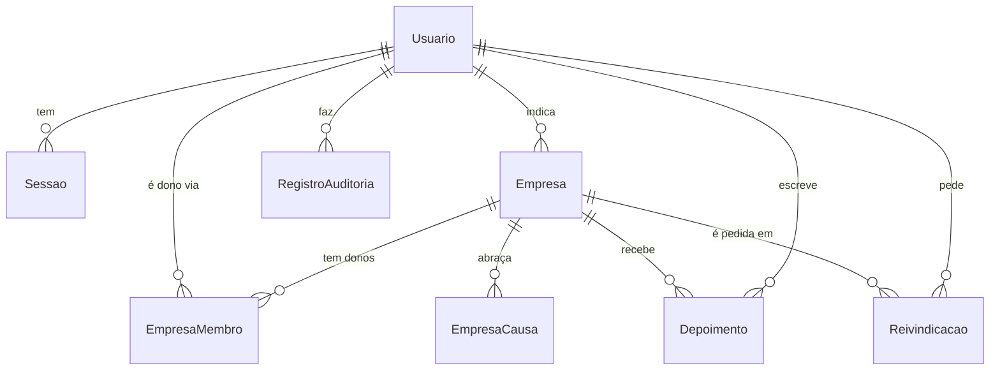

# Como o projeto foi feito

Este guia conta o raciocínio por trás do Negócio do Bem: o propósito, os princípios que guiaram cada decisão, a ordem em que as coisas foram construídas, como o código está organizado e como mexer nele com segurança.

As regras em si, uma por uma, estão em [Regras de negócio](regras-de-negocio.md). Para rodar o projeto, veja o [README](../README.md#rodando-localmente). Para abrir um pull request, veja o [CONTRIBUTING](../CONTRIBUTING.md).

## Sumário

1. [Por que o projeto existe](#1-por-que-o-projeto-existe)
2. [Os princípios por trás das decisões](#2-os-princípios-por-trás-das-decisões)
3. [Como o projeto foi construído, passo a passo](#3-como-o-projeto-foi-construído-passo-a-passo)
4. [Arquitetura](#4-arquitetura)
5. [Padrões do código](#5-padrões-do-código)
6. [Testes](#6-testes)
7. [Publicação e infraestrutura](#7-publicação-e-infraestrutura)
8. [Receitas para mudanças comuns](#8-receitas-para-mudanças-comuns)
9. [Armadilhas conhecidas](#9-armadilhas-conhecidas)
10. [Como trabalhamos](#10-como-trabalhamos)

---

## 1. Por que o projeto existe

O Negócio do Bem nasceu para dar visibilidade a quem cuida das pessoas, da comunidade e do planeta. A página [Como funciona](https://negociodobem.vercel.app/sobre) resume a ideia: quando negócios são atacados por defenderem o respeito e a dignidade, a melhor resposta é coletiva. A comunidade encontra, indica e fortalece quem faz o bem.

Daí saem as três peças do produto:

- **Um diretório** onde as pessoas encontram negócios pelas causas que importam para elas (escala 5x2, antirracista, pet friendly, liderado por mulheres…), pela cidade e pelo estado.
- **A voz da comunidade:** qualquer pessoa indica um negócio e deixa depoimentos.
- **A voz do dono:** quem cuida do negócio assume o perfil e conta a própria história.

## 2. Os princípios por trás das decisões

Quase toda regra do sistema sai de um destes princípios. Diante de uma decisão nova, comece por eles.

### A comunidade indica, o dono confirma, a moderação garante

O diretório cresce sem precisar que os donos se cadastrem primeiro: qualquer pessoa indica. Isso traz um risco, que é alguém se passar pelo dono ou cadastrar um perfil falso. A resposta tem três partes:

- **Antes de publicar, a moderação revisa cada indicação.**
- **O selo diz quem falou.** "Indicado pela comunidade" e "Verificado pelo dono" são selos diferentes, então quem visita sabe se o perfil foi confirmado.
- **Ninguém vira dono sem prova.** A moderação confere CNPJ, site e contato com o @ do Instagram antes de aprovar.

### O @ do Instagram é a identidade do negócio

Cada negócio é o seu @: ele é único, é o endereço da página (`/empresas/<@>`) e é o que a moderação abre para comparar com os dados enviados.

- **Por que o @:** é público, fácil de achar e de digitar, e quem indica normalmente já sabe qual é.
- **Por que só o @ não basta:** um @ pode ser abandonado e registrado por outra pessoa. Por isso, nos caminhos de verificação pelo Instagram, o perfil fica ligado ao **ID fixo da conta**, e uma conta diferente da registrada nunca é aprovada sozinha.

### Na dúvida, uma pessoa decide

- **Quando a máquina aprova sozinha:** só nos caminhos pelo Instagram, e só quando não há nenhum conflito.
- **Quando uma pessoa decide:** em qualquer situação estranha. O negócio já tem dono, o @ trocou de conta, ou a conta está ligada a outro perfil.
- **O que a pessoa da moderação recebe:** uma anotação explicando o que aconteceu, e a escolha entre adicionar como co-dono ou transferir.
- **O que fica registrado:** toda decisão vai para a auditoria.

### A confiança da comunidade vem antes do controle do dono

- **O dono responde, mas não apaga depoimentos.**
- **Denunciar não esconde o depoimento.** Só a moderação remove, e a decisão fica registrada.

Assim, um depoimento negativo e honesto não some só porque incomodou o dono, e um depoimento ofensivo tem um caminho claro para sair.

### Privacidade por padrão

- **Dados mínimos:** da conta, só nome e e-mail.
- **Nada de raspagem:** o site não raspa o Instagram.
- **Nada de tokens guardados:** o login com Instagram só serve para provar quem controla a conta.
- **Só imagens próprias:** o site só mostra fotos que ele mesmo guardou, porque uma imagem de outro endereço avisaria aquele servidor a cada visita.
- **Direito de não aparecer:** o dono oculta o negócio a qualquer momento. É a resposta para quem foi indicado e não quer estar no diretório.

### Sem ranking e sem anúncio pago

A ordem do diretório é simples e transparente: verificados primeiro, depois os atualizados mais recentemente. Não existe nota, destaque pago nem algoritmo de relevância.

### Funcionar sem depender de terceiros

O site precisa funcionar mesmo quando um serviço de fora falha ou ainda não foi configurado:

| Serviço | Sem ele, o site… |
| --- | --- |
| Integração com o Instagram | Funciona: a reivindicação pelos dados do negócio continua disponível. |
| Consulta de CNPJ (BrasilAPI) | Funciona: a consulta é só um apoio para a moderação, nunca bloqueia a análise. |
| Google Analytics | Funciona: sem o ID, ele simplesmente não carrega. |
| Vercel Blob | Funciona. No computador de quem desenvolve, as fotos ficam numa pasta local. Em produção, só o envio de fotos mostra um erro. |

### Tudo em português

Código, nomes de tabelas, rotas, mensagens e documentação estão em português do Brasil (`empresa`, `reivindicacao`, `depoimento`, `causas`, `exigirModerador`). O público é brasileiro, e quem colabora lê o código na mesma língua do produto.

---

## 3. Como o projeto foi construído, passo a passo

O projeto foi construído em outubro de 2026, com a ajuda do [Claude Code](https://claude.com/claude-code). O `AGENTS.md` e o `CLAUDE.md` guiam os agentes de IA que trabalham no repositório. O histórico do Git e os pull requests contam os detalhes.

### 28 de outubro: a primeira versão

A primeira versão já trouxe o produto completo:

- o diretório com busca e filtros;
- os perfis com história em Markdown;
- a indicação pela comunidade;
- o painel do dono;
- a moderação com filas, transferência em disputas e auditoria;
- os testes de banco para as regras de reivindicação.

A reivindicação nasceu com **três caminhos**:

| Caminho | Como funciona |
| --- | --- |
| **Entrar com Instagram** | Na hora: o Instagram confirma qual conta a pessoa controla. |
| **Código por DM** | A pessoa manda um código a partir do @ do negócio para o perfil oficial do projeto. |
| **Dados do negócio** | A moderação confere CNPJ e contato. |

Logo depois, o Postgres do Docker passou para a porta **5433**, para não brigar com um Postgres já instalado no computador.

### 28 de outubro: a reivindicação fica simples ([#2](https://github.com/fabsreis/Negocio-do-bem/pull/2))

Os dois caminhos pelo Instagram dependem da Meta:

- um app aprovado na revisão da Meta;
- a verificação do negócio;
- um perfil oficial definido;
- um token que vence e precisa ser renovado.

Para colocar o projeto no ar sem esperar tudo isso, a reivindicação passou a ter **um caminho só**: a pessoa envia os dados do negócio (CNPJ ou MEI, site, relação com o negócio e contato) e a moderação confere com o @ do Instagram.

**Nada foi apagado.** O código, as rotas e os testes dos caminhos pelo Instagram continuam no projeto e ligam sozinhos quando as variáveis de ambiente são preenchidas.

No mesmo dia, o README ganhou os prints das telas ([#1](https://github.com/fabsreis/Negocio-do-bem/pull/1)).

### 29 de outubro: código aberto e no ar ([#3](https://github.com/fabsreis/Negocio-do-bem/pull/3))

O repositório virou código aberto:

- licença MIT;
- `CONTRIBUTING.md` e `SECURITY.md`;
- verificações automáticas em todo PR;
- a branch principal renomeada para `main`.

O site passou a dizer, no rodapé e em "Como funciona", que o código é aberto, porque transparência sobre como os dados são tratados faz parte da proposta.

No mesmo PR, o site foi publicado no Vercel. O banco é um Postgres no Neon, e as migrações rodam a cada deploy de produção (`scripts/vercel-build.sh`). As funções ficam em São Paulo (`gru1`), perto do banco e do público.

### 29 de outubro: foto, contatos e história com fotos ([#4](https://github.com/fabsreis/Negocio-do-bem/pull/4))

Primeiro pedido depois do lançamento: o perfil precisava de mais vida e de mais formas de contato.

- **Foto do perfil:**
  - o navegador reduz a foto antes de enviar;
  - o servidor confere o tipo pelos primeiros bytes;
  - ela fica guardada no Vercel Blob.
- **Contatos:** WhatsApp, e-mail e site viram botões no perfil.
- **História com fotos e legendas.**

A ideia de puxar a foto direto do Instagram ficou para depois, porque só funciona pela API oficial e com contas comerciais.

### 29 de outubro: issues e pull requests ([#6](https://github.com/fabsreis/Negocio-do-bem/pull/6))

O projeto adotou o fluxo descrito em [Como trabalhamos](#10-como-trabalhamos): issue antes do código, branch por issue, PR com revisão e deploy só pelo merge. A `main` ficou protegida.

### 29 de outubro: a moderação edita qualquer perfil ([#9](https://github.com/fabsreis/Negocio-do-bem/pull/9))

A moderação precisava corrigir um telefone ou trocar a foto de qualquer negócio, sem depender do dono.

- **Uma tela só, para dono e moderação.** A moderação usa o mesmo formulário do dono (`EdicaoEmpresa`), aberto pelo painel de moderação. Assim, uma melhoria no formulário vale para os dois.
- **Rastro na auditoria.** Cada edição da moderação ganha o sufixo `_pela_moderacao`.
- **Ocultar continua só do dono.**

### 29 de outubro: a história no estilo Substack ([#10](https://github.com/fabsreis/Negocio-do-bem/pull/10))

O campo de Markdown virou um editor visual (Tiptap), com títulos, citações, listas, separadores e fotos com legenda.

A decisão importante: **a história continua guardada em Markdown.** Por isso:

- as histórias antigas abrem sem migração;
- o perfil continua usando o mesmo componente seguro de exibição;
- em troca, o editor só oferece o que o Markdown guarda (nada de sublinhado ou cores).

### 29 de outubro: modo escuro ([#12](https://github.com/fabsreis/Negocio-do-bem/pull/12))

O switch no cabeçalho alterna entre claro e escuro.

- **Na primeira visita,** o site segue o sistema da pessoa. Depois, a escolha fica salva no navegador.
- **Sem piscar:** um script no `<head>` aplica o tema antes da primeira pintura.
- **As cores são variáveis do tema.** As classes não mudam: o que muda é o valor de cada cor.

### 29 de outubro: Google Analytics ([#14](https://github.com/fabsreis/Negocio-do-bem/pull/14))

O objetivo era medir o tráfego do site.

- **Só em produção:** o Analytics carrega apenas quando `NEXT_PUBLIC_GA_ID` existe, e ela só está configurada em Production. Cópias do projeto e previews não mandam dados.
- **Sem aviso de cookies:** foi uma decisão do projeto. A seção de privacidade de "Como funciona" explica a medição.

---

## 4. Arquitetura

### A stack e por que cada peça

| Peça | Versão | Por quê |
| --- | --- | --- |
| **Next.js** (App Router, Cache Components) | 16.4 | Páginas renderizadas no servidor e Server Actions para os formulários: os formulários funcionam até antes do JavaScript carregar, e a permissão é conferida no servidor. |
| **React** | 19 | `useActionState` para os formulários e `useSyncExternalStore` para o tema. |
| **PostgreSQL + Prisma** | Prisma 7 | Banco relacional para dados com relações e regras de unicidade (um @ por negócio, um depoimento por pessoa). O Prisma dá tipos e migrações versionadas. |
| **Zod** | 4 | Validação de cada formulário no servidor, com mensagens em português. |
| **Tailwind CSS** | 4 | Estilo com variáveis de tema (`@theme`), o que permite o modo escuro sem trocar classes. |
| **Tiptap** | 3.31 | Editor visual da história, com leitura e gravação em Markdown. |
| **react-markdown + remark-gfm** | 10 | Exibição da história sem executar HTML. |
| **Vercel Blob** | 2.8 | Armazenamento das fotos em produção. |
| **Vitest** | 5 | Testes de unidade e de banco. |

A autenticação é feita no próprio projeto (`src/lib/auth/`), com e-mail, senha (scrypt) e sessão em cookie. Isso evita depender de um serviço externo para algo simples.

### Como uma requisição anda



As linhas tracejadas são serviços opcionais. O site funciona sem eles.

### Onde fica cada coisa

| Pasta | Conteúdo |
| --- | --- |
| `prisma/` | Esquema do banco (`schema.prisma`), migrações e dados de exemplo (`seed.ts`). |
| `src/app/` | Páginas e rotas. Cada pasta é um endereço: `empresas/[usuario]` é o perfil, `painel/` é o painel do dono, `moderacao/` é a moderação, `api/` tem as rotas do Instagram. |
| `src/acoes/` | Server Actions, uma por formulário ou botão. Conferem a permissão e validam os dados. |
| `src/lib/` | Regras de negócio e utilitários, sem interface: `reivindicacao.ts`, `consultas.ts`, `instagram.ts`, `causas.ts`, `cnpj.ts`, `formulario.ts`, `armazenamento.ts`, `auth/`… |
| `src/components/` | Componentes de interface reutilizados entre páginas. |
| `tests/` | `unit/` (sem banco) e `db/` (com banco). |
| `docs/` | Esta documentação e os prints do README. |

### O banco



Decisões do esquema:

- **Status como texto, não `enum`,** para o esquema ser simples de evoluir. Os valores aceitos estão comentados no `schema.prisma` e os rótulos em `src/lib/dominio.ts`.
- **Um campo `busca`** guarda nome, resumo, categoria, cidade, UF e @ em minúsculas e sem acento. Ele é atualizado a cada indicação e edição. Assim, a busca sem acento é um `contains` simples, sem extensão no Postgres.
- **As causas ficam no código** (`src/lib/causas.ts`), e o banco guarda só o slug. Criar uma causa é mudar uma linha, sem migração.
- **Unicidade garantida pelo banco:**
  - um @ por negócio;
  - um ID de conta do Instagram por negócio;
  - um depoimento por pessoa por negócio;
  - um código de DM único.
- **O que acontece ao apagar** (não há tela para isso hoje, só direto no banco):
  - **uma conta:** apaga as sessões, os vínculos de dono, os pedidos de reivindicação e os depoimentos dela. Os negócios que ela indicou, as decisões que tomou e os registros de auditoria ficam, sem o autor;
  - **um negócio:** apaga as causas, os donos, os depoimentos e os pedidos ligados a ele.

---

## 5. Padrões do código

Siga estes padrões numa mudança nova. Eles estão em todo o projeto.

### Server Actions

Cada formulário chama uma função em `src/acoes/`, sempre na mesma ordem:

1. **Confere quem está pedindo,** com uma destas funções:
   - `exigirUsuario` (precisa de login);
   - `exigirDono` (precisa ser dono);
   - `exigirEditor` (dono ou moderação);
   - `exigirModerador` (moderação, senão 404).

   Nunca confie em um botão escondido: a conferência é sempre no servidor.
2. **Valida os dados com Zod.** Os campos reaproveitáveis (`campoSite`, `campoWhatsapp`, `campoEmail`) estão em `src/lib/formulario.ts`.
3. **Faz a mudança no banco.** Use uma transação quando mais de uma tabela muda junto.
4. **Registra na auditoria** se for uma decisão ou edição importante.
5. **Redireciona com um aviso:** `?aviso=codigo`, com o texto em `src/lib/avisos.ts`.

Quando há erro de validação, a ação devolve um `EstadoFormulario` com os erros por campo e os valores enviados. Assim o formulário mostra o erro sem perder o que a pessoa digitou.

No cliente, os formulários com `useActionState` usam `enviarSemLimpar` (`src/components/envio.ts`). Sem ele, o React 19 limpa o formulário depois do envio e apagaria selects, checkboxes e a história em edição.

### Páginas e Cache Components

- O `cacheComponents` está ligado. Por isso, tudo que lê cookies, `params`, `searchParams` ou o banco fica **dentro de um `<Suspense>`**, com um esqueleto de carregamento no `fallback`. As páginas seguem o formato:

  ```tsx
  export default function Pagina(props) {
    return (
      <Suspense fallback={<Carregando />}>
        <Conteudo params={props.params} />
      </Suspense>
    );
  }
  ```

- **Os dados do banco não usam `use cache`,** para estarem sempre atualizados.
- `usuarioAtual()` usa o `cache` do React: a sessão é lida uma vez por requisição, mesmo que vários componentes perguntem.

### Regras de negócio fora da interface

Regra que decide algo importante vai para `src/lib/`, separada da tela e da Server Action. Assim ela pode ser testada sem navegador.

O melhor exemplo é `src/lib/reivindicacao.ts`: as Server Actions e as rotas do Instagram só chamam as funções de lá.

Erros que podem ser mostrados para a pessoa usam uma classe própria (`ErroReivindicacao`). Os outros erros sobem normalmente.

### Interface

- **Componentes de formulário:** `Campo` (rótulo, ajuda e erro), `BotaoEnviar` (mostra "Enviando…"), `Aviso`.
- **Classes de `globals.css`:** `.botao`, `.botao-coral`, `.botao-claro`, `.cartao`, `.campo`, `.link` e `.historia`. Prefira essas classes a repetir utilitários do Tailwind.
- **Cores do tema:** `papel`, `superficie`, `tinta`, `suave`, `linha`, `coral` e `folha`. Para algo que só muda no escuro, use a variante `escuro:`.
- **Cor fixa nunca:** `bg-white` e afins não mudam no modo escuro. Use `superficie`.
- **Tipografia:** textos longos usam a fonte serifada (Newsreader), e a interface usa a Inter.

---

## 6. Testes

```bash
npm test          # precisa do Postgres rodando
npm run lint
npm run typecheck
```

- **`tests/unit/`:** funções sem banco. Cobrem CNPJ, senha, normalização de texto, causas, campos de formulário, tempo de leitura, fotos e Instagram.
- **`tests/db/`:** as regras de reivindicação contra um Postgres de verdade:
  - código por DM;
  - Entrar com Instagram;
  - conflitos;
  - transferência;
  - dados do negócio;
  - limite diário.
- **O banco de teste é separado** (`negocio_do_bem_teste`, ou o de `TEST_DATABASE_URL`).
  - Ele é criado na primeira execução e as tabelas são limpas entre os testes.
  - A suíte se recusa a rodar se o nome do banco não tiver "test", para nunca apagar dados de desenvolvimento.
- **No GitHub,** o CI roda lint, tipos e testes num Postgres temporário em todo PR e a cada push na `main`.

**A regra do projeto:** mudou uma regra em `src/lib/reivindicacao.ts`, atualize ou crie o teste em `tests/db/`. Para outras regras de `src/lib/`, um teste em `tests/unit/` é muito bem-vindo.

---

## 7. Publicação e infraestrutura

| Peça | Onde | Observação |
| --- | --- | --- |
| Site | Vercel, funções em São Paulo (`gru1`) | Produção em https://negociodobem.vercel.app |
| Banco | Neon (PostgreSQL), São Paulo | Conectado ao Vercel, que cria `DATABASE_URL` e `DATABASE_URL_UNPOOLED`. |
| Fotos | Vercel Blob, público | Conectado ao Vercel, que cria `BLOB_READ_WRITE_TOKEN`. |
| Medição | Google Analytics 4 | `NEXT_PUBLIC_GA_ID` só em Production. |

**Como um deploy acontece:**

1. O merge na `main` dispara o deploy de produção no Vercel.
2. O `scripts/vercel-build.sh` aplica as migrações pendentes (`prisma migrate deploy`) usando a conexão direta do Neon. Depois, roda o build.
3. Cada PR ganha um **preview** do Vercel, que serve de homologação.
   - O build do preview não aplica migrações: só o de produção aplica.
   - Num PR que muda o banco, as telas que dependem da mudança podem falhar no preview. Teste essas telas no seu computador.

**Variáveis de ambiente:**

| Variável | Obrigatória | Para quê |
| --- | --- | --- |
| `DATABASE_URL` | Sim | Conexão com o Postgres. |
| `DATABASE_URL_UNPOOLED` | No Neon | Conexão direta, usada pelas migrações. |
| `APP_URL` | Sim | Endereço público do site, sem barra no final. |
| `ADMIN_EMAILS` | Sim | E-mails da moderação, separados por vírgula. |
| `BLOB_READ_WRITE_TOKEN` | Em produção | Fotos no Vercel Blob. |
| `NEXT_PUBLIC_GA_ID` | Não | Google Analytics. Configure só em Production. |
| `INSTAGRAM_PERFIL_OFICIAL` | Não | Liga o código por DM. |
| `INSTAGRAM_APP_ID`, `INSTAGRAM_APP_SECRET`, `INSTAGRAM_GRAPH_VERSION` | Não | Ligam o "Entrar com Instagram". |
| `INSTAGRAM_ACCESS_TOKEN`, `INSTAGRAM_WEBHOOK_VERIFY_TOKEN` | Não | Ligam a confirmação automática da DM. |

O `.env.example` explica cada uma, e o [README](../README.md#publicando) tem o passo a passo de publicação.

**Nunca rode o seed em produção.** Ele cria contas com senha conhecida e se recusa a rodar quando `NODE_ENV=production`.

---

## 8. Receitas para mudanças comuns

### Criar uma causa

1. Acrescente a causa em `CAUSAS`, em `src/lib/causas.ts`, com slug, nome, emoji, descrição e grupo.
2. Pronto: ela aparece nos filtros, nos formulários e em "Como funciona".

Para trocar o slug de uma causa existente, crie uma migração que atualize `EmpresaCausa`.

### Acrescentar um campo ao negócio

1. Acrescente o campo em `Empresa`, no `prisma/schema.prisma`, com um comentário.
2. Crie a migração: `npm run db:migrate -- --name descricao-curta`.
3. Valide o campo no Zod de `src/acoes/empresas.ts`: em `camposComuns`, `camposContato` ou `esquemaEdicao`.
4. Acrescente o campo nos formulários:
   - `src/app/painel/[usuario]/FormEmpresa.tsx`;
   - `EdicaoEmpresa.tsx`, que passa os dados ao formulário;
   - `src/app/indicar/FormIndicar.tsx`, se quem indica também puder preencher.
5. Se o campo deve entrar na busca, inclua em `textoDeBusca` (`src/lib/texto.ts`). Os negócios que já existem só são atualizados quando forem editados.
6. Mostre o campo no perfil (`src/app/empresas/[usuario]/page.tsx`) e, se fizer sentido, na fila de indicações da moderação.
7. Atualize os dados de exemplo em `prisma/seed.ts`.
8. Atualize a [seção 3 das regras de negócio](regras-de-negocio.md#dados-do-negócio).

### Mudar uma regra da reivindicação

1. Mude a regra em `src/lib/reivindicacao.ts`, não na tela.
2. Atualize ou crie o teste em `tests/db/reivindicacao.test.ts`.
3. Confira os textos da página de reivindicação, de "Como funciona" (`src/app/sobre/page.tsx`) e do README.
4. Atualize a [seção 6 das regras de negócio](regras-de-negocio.md#6-reivindicação-como-o-dono-assume-o-perfil).

### Criar uma ação de moderação

1. Crie a Server Action em `src/acoes/moderacao.ts`, começando por `exigirModerador()`.
2. Registre na auditoria com `registrarAuditoria`, com uma ação no formato `alvo.verbo` (por exemplo, `empresa.despublicada`).
3. Volte para a aba certa com um aviso: `redirect("/moderacao?aba=…&aviso=feito")`.
4. Atualize a [tabela da auditoria](regras-de-negocio.md#13-auditoria).

### Mostrar uma mensagem depois de uma ação

1. Acrescente um código e o texto em `AVISOS`, em `src/lib/avisos.ts`.
2. Redirecione com `?aviso=<codigo>`.
3. Confira se a página destino tem `<AvisoDaUrl codigo={aviso} />`.

### Ligar a verificação pelo Instagram

Siga as seções "Ativando…" do [README](../README.md#ativando-o-código-por-dm-opcional). Depois de ligar, atualize "Como funciona" (`src/app/sobre/page.tsx`), que hoje só descreve o envio de dados do negócio.

---

## 9. Armadilhas conhecidas

- **Esta versão do Next.js é diferente** da que muitos tutoriais e modelos de IA conhecem. Na dúvida, consulte os guias em `node_modules/next/dist/docs/`.
- **Erro "cookies object that does not match" em `next dev`.**
  - Quando uma Server Action devolve erro de validação, o modo de desenvolvimento às vezes mostra esse erro interno do Next.
  - Ele não acontece no build de produção (`next build && next start`).
- **CSS desatualizado em `next dev`.** Se uma mudança de estilo não aparece, pare o servidor, apague `.next/dev` e rode de novo.
- **"User was denied access on the database"** quase sempre é o `DATABASE_URL` apontando para outro Postgres na porta 5432. O do Docker usa a **5433**. Veja os [problemas comuns do README](../README.md#problemas-comuns).
- **O `next dev` reescreve o começo do `AGENTS.md`.** Escreva as regras do projeto **depois** do bloco que ele gerencia.
- **Fotos no computador de quem desenvolve** ficam em `public/enviados/`, que está fora do Git. Os links delas não funcionam em outro computador.

---

## 10. Como trabalhamos

O fluxo completo está no [CONTRIBUTING](../CONTRIBUTING.md). Em resumo:

1. **Issue antes de codar,** com o label `bug`, `enhancement` ou `feature`.
2. **Uma branch por issue,** no formato `tipo/numero-da-issue-descricao-curta`. Exemplo: `bug/12-erro-no-login`.
3. **Pull request para a `main`,** com `Closes #N` ou `Refs #N`, explicando o que muda e por quê, com print se mexeu na interface.
4. **A checagem "Lint, tipos e testes" e uma aprovação** antes do merge.
5. **Deploy só pelo merge.** Nada de deploy manual.

E dois combinados que mantêm esta documentação útil:

- **Mudou uma regra de negócio?** Atualize o [Regras de negócio](regras-de-negocio.md) no mesmo PR.
- **Tomou uma decisão que muda o rumo do projeto?** Conte o porquê na descrição do PR e, se for uma decisão de fundo, aqui neste guia.
