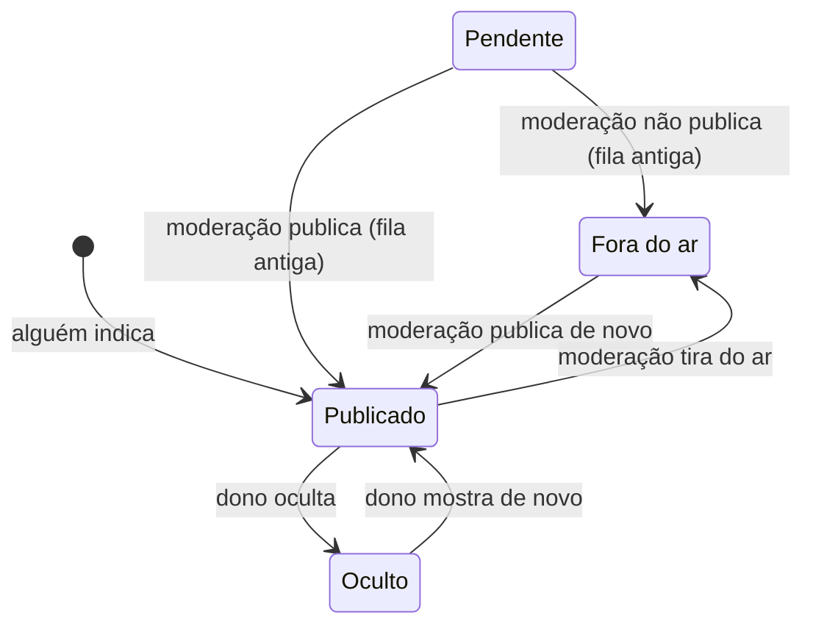

# Regras de negócio

Este documento descreve como o Negócio do Bem funciona hoje, regra por regra, do jeito que está no código. Serve para quem vai colaborar entender o que o sistema faz, por que faz e onde cada regra mora antes de mudar alguma coisa.

O código é a fonte da verdade. Se o código e este documento discordarem, um dos dois está errado: corrija no mesmo pull request. Mudou uma regra? Atualize este arquivo junto.

O raciocínio por trás das decisões e a história do projeto estão em [Como o projeto foi feito](como-foi-feito.md).

## Sumário

1. [Glossário](#1-glossário)
2. [Contas e papéis](#2-contas-e-papéis)
3. [O negócio: identidade, dados e estados](#3-o-negócio-identidade-dados-e-estados)
4. [Indicação e cadastro por etapas](#4-indicação-e-cadastro-por-etapas)
5. [Moderação das indicações](#5-moderação-das-indicações)
6. [Reivindicação: como o dono assume o perfil](#6-reivindicação-como-o-dono-assume-o-perfil)
7. [Perfil público e painel do dono](#7-perfil-público-e-painel-do-dono)
8. [História do negócio](#8-história-do-negócio)
9. [Fotos](#9-fotos)
10. [Depoimentos e denúncias](#10-depoimentos-e-denúncias)
11. [Diretório e busca](#11-diretório-e-busca)
12. [Causas, categorias e estados do Brasil](#12-causas-categorias-e-estados-do-brasil)
13. [Auditoria](#13-auditoria)
14. [Avisos por e-mail](#14-avisos-por-e-mail)
15. [Privacidade: o que guardamos e quem vê](#15-privacidade-o-que-guardamos-e-quem-vê)
16. [Números e limites](#16-números-e-limites)
17. [Comportamentos atuais que valem conhecer](#17-comportamentos-atuais-que-valem-conhecer)

---

## 1. Glossário

| Termo | No código | O que é |
| --- | --- | --- |
| Negócio | `Empresa` | Um negócio do diretório. Cada um é identificado pelo @ do Instagram. |
| Conta | `Usuario` | Quem se cadastrou com e-mail e senha. |
| Dono | `EmpresaMembro` com `papel = "dono"` | Uma conta responsável por um negócio: aprovada na hora pelo Instagram, ou pela moderação. Um negócio pode ter mais de um dono (co-donos). |
| Moderação | `Usuario.papel = "moderador"` | Quem tira do ar o que for impróprio, decide disputas de reivindicação e denúncias, e pode editar qualquer perfil. |
| Indicação | criação de uma `Empresa` | Alguém da comunidade (ou o próprio dono) cadastra um negócio. |
| Reivindicação | `Reivindicacao` | O pedido de uma pessoa para virar dona de um negócio. |
| Perfil oficial | `Empresa.oficial` | O selo do negócio em que um dono atual confirmou pelo Instagram (login ou código por DM). |
| Depoimento | `Depoimento` | O relato de alguém da comunidade sobre um negócio. |
| Denúncia | campos `denunciado`, `motivoDenuncia` e `denunciadoPorId` do `Depoimento` | O aviso de que um depoimento tem algo errado. |
| Causa | `EmpresaCausa` + lista em `src/lib/causas.ts` | Um valor que o negócio pratica, como "Escala 5x2" ou "Antirracista". Vira selo no perfil e filtro na busca. |
| Auditoria | `RegistroAuditoria` | O registro de quem fez o quê nas ações importantes. |

Os status são texto, e não `enum` do banco, para o esquema ser simples de evoluir. Os valores aceitos estão comentados em `prisma/schema.prisma` e os rótulos em `src/lib/dominio.ts`.

---

## 2. Contas e papéis

### Cadastro e login

Código: `src/acoes/conta.ts`, `src/lib/auth/`.

- **Cadastro** (`/cadastrar`):
  - nome de 2 a 80 caracteres;
  - e-mail válido de até 200 caracteres, guardado em minúsculas;
  - senha de 8 a 200 caracteres.
- **Um e-mail, uma conta.** O cadastro avisa quando o e-mail já existe ("Que tal entrar?").
- **Login** (`/entrar`): e-mail e senha.
  - O erro é sempre o mesmo, "E-mail ou senha incorretos".
  - Quando o e-mail não existe, a senha é conferida contra um hash falso, para a resposta levar o mesmo tempo e não revelar quais e-mails têm conta.
- **Limite de tentativas** (`src/lib/auth/tentativas.ts`), conferido antes do scrypt, porque cada conferência de senha custa ~32 MB de memória:
  - **por IP:** 10 tentativas de login ou cadastro, somadas, a cada 15 minutos;
  - **de onde vem o IP:** no Vercel, só do cabeçalho `x-vercel-forwarded-for`, que o Vercel escreve. Em outra hospedagem, de nenhum cabeçalho, a menos que quem cuida do site defina `AUTENTICACAO_PROXY_CONFIAVEL=1` (há um proxy seu na frente, que escreve o `x-forwarded-for`): então vale o último valor desse cabeçalho, se for um IP. Um cabeçalho que o visitante pode escrever nunca vale;
  - **IPv6:** o IPv4 escrito como IPv6 (`::ffff:203.0.113.5`) conta como o IPv4. Os outros endereços IPv6 contam pelo prefixo /64, então todos os endereços da mesma rede dividem a cota;
  - **sem IP conhecido** (fora do Vercel sem proxy declarado, ou cabeçalho ausente ou inválido), todas as tentativas dividem um contador só, de 10 a cada 15 minutos. É o lado seguro: o cadastro não tem limite por e-mail, e sem esse contador o scrypt ficaria sem freio. O custo é que, sem o proxy declarado, quem tenta entrar pode ficar recusado por causa dos outros visitantes;
  - **por e-mail, em cada origem:** 5 tentativas de senha a cada 15 minutos para o mesmo e-mail, vindas do mesmo IP (ou do mesmo /64 no IPv6). Cada origem tem o próprio contador, então quem erra a senha de outra pessoa não a impede de entrar de outro lugar. Sem IP conhecido, as tentativas sem IP dividem um contador por e-mail. A tentativa é contada antes de a senha ser conferida, e não depois: assim, tentativas que chegam juntas não passam todas. A sexta já nem chega à conferência, mesmo com a senha certa. Um login certo zera a contagem daquele e-mail naquela origem;
  - no login, a recusa pelo limite mostra o mesmo "E-mail ou senha incorretos", para não revelar quais e-mails existem. No cadastro, aparece "Muitas tentativas seguidas. Espere alguns minutos e tente de novo";
  - o banco guarda só o hash (sha256) do IP e do e-mail, e as janelas vencidas são apagadas na tentativa seguinte.
- **Senha:**
  - guardada com scrypt (N=2^15, r=8, p=1, sal aleatório de 16 bytes) no formato `scrypt$N$r$p$sal$hash`;
  - a comparação é em tempo constante.
- **Sessão:**
  - dura 30 dias;
  - o cookie `ndb_sessao` é `httpOnly`, `sameSite=lax` e `secure` em produção, e guarda um token aleatório;
  - o banco guarda só o SHA-256 do token, então quem lê o banco não consegue se passar pela pessoa;
  - "Sair" apaga a sessão do banco e o cookie.
- **Volta para onde a pessoa estava:**
  - páginas que exigem login mandam para `/entrar?voltar=<caminho>`;
  - o `voltar` só aceita caminhos internos (`caminhoSeguro`), para não virar um redirecionamento para outro site. A busca e a âncora do caminho vão junto: `/participar?continuar=1#cadastro` volta inteiro;
  - `caminhoSeguro` recusa o valor com caractere de controle (de U+0000 a U+001F e U+007F, como TAB, LF e CR), com `//` no começo ou com barra invertida;
  - depois ele interpreta o valor como URL (padrão WHATWG) e só aceita se a origem continuar a do site, porque o TAB, o LF e o CR somem na interpretação e `/<TAB>/host` viraria `//host`;
  - o que ele recusa cai no destino padrão, e o caminho interno válido (com consulta e âncora) passa sem mudar.

### E-mail confirmado e links por e-mail

Código: `src/lib/auth/links.ts`, `src/acoes/conta.ts`, `src/app/api/link/route.ts` e `src/app/link/page.tsx`.

- **O cadastro manda um link de confirmação** para o e-mail digitado. A conta já entra no site na hora.
- **Sem o e-mail confirmado, a conta não** indica negócios, não escreve nem denuncia depoimentos e não reivindica negócios, por nenhum dos caminhos.
  - Nesses lugares, e no topo do `/painel`, aparece "Confirme seu e-mail", com um botão para mandar o link de novo.
  - As Server Actions conferem de novo no servidor e respondem "Antes, confirme o seu e-mail".
- **O resto funciona sem confirmar:** entrar, sair, o painel, editar o próprio negócio, responder depoimentos e cancelar pedidos.
- **Contas criadas antes da confirmação existir** (`emailConfirmadoEm` vazio) confirmam na próxima vez que forem fazer uma dessas ações.
- **Entrar por link** (`/entrar/link`, também em "Esqueceu a senha?" no `/entrar`): a pessoa digita o e-mail e recebe um link para entrar sem senha.
  - A resposta é sempre "Confira seu e-mail", com ou sem conta para aquele endereço.
  - O link é criado e mandado depois da resposta, para o tempo de resposta também não revelar quais e-mails têm conta.
  - A senha continua valendo. Entrar por link não muda a senha.
- **Os dois links:**

  | Link | Vale por | Ao usar |
  | --- | --- | --- |
  | Confirmar o e-mail | 24 horas | Confirma o e-mail. Não abre sessão. |
  | Entrar | 15 minutos | Abre a sessão e também confirma o e-mail. |

- **Cada link vale uma vez.** Dois cliques ao mesmo tempo usam o link uma vez só.
- **O link só vale para o e-mail para onde foi.** Se a conta mudar de e-mail, os links antigos deixam de valer.
- **Abrir o link não usa o link.** `/api/link` guarda o token num cookie (`ndb_link`, `httpOnly`, só no caminho `/link`) e leva a `/link`, que mostra a conta e pede um clique em "Entrar" ou em "Confirmar meu e-mail".
  - Filtros de e-mail que abrem links sozinhos (Outlook, antivírus) não gastam o link nem confirmam um e-mail sem a pessoa.
  - O token sai do endereço antes de a página carregar o Google Analytics.
- **Depois do clique,** o link de entrar leva ao `voltar` de quando foi pedido. O de confirmar mostra "E-mail confirmado" e um botão para continuar de onde a pessoa estava.
- **O banco guarda só o SHA-256 do token,** como na sessão.
- **Limite:** no máximo **5 links por conta a cada hora**, somando os dois tipos.
  - Ao mandar de novo a confirmação, quem passou do limite vê "Você pediu muitos e-mails na última hora".
  - No "Entrar por link", a resposta continua a mesma, e o e-mail simplesmente não sai.
  - Os links vencidos há mais de uma hora são apagados quando a conta recebe outro.
- **O endereço do link vem da configuração** (`ENDERECO_DO_SITE`, ou o endereço do próprio preview nos previews do Vercel), nunca do cabeçalho `Host` da requisição.
- **Sem o envio de e-mail configurado,** o link vai para o log do servidor no `npm run dev` e nos previews, para dar para testar. Na produção, ele não vai para o log.

### Papéis

Um papel não exclui o outro: uma pessoa da moderação também pode ser dona de um negócio.

| Papel | Quem é | O que pode fazer |
| --- | --- | --- |
| **Visitante** | Sem login | Ver o diretório, os perfis publicados e os depoimentos. Não indica, não escreve depoimento, não reivindica. |
| **Membro** | Qualquer conta | Ver as próprias indicações e solicitações em `/painel`. Com o [e-mail confirmado](#e-mail-confirmado-e-links-por-e-mail): indicar negócios, escrever e denunciar depoimentos e reivindicar um negócio. |
| **Dono** | Conta aprovada como dona de um negócio | Tudo do membro, mais: editar o perfil do próprio negócio, trocar a foto, responder depoimentos e ocultar ou mostrar o negócio no diretório. Não pode escrever depoimento no próprio negócio. |
| **Moderação** | `papel = "moderador"` no banco | Tudo do membro, mais: o painel de `/moderacao` (visão geral, filas, todos os negócios, contas e depoimentos, auditoria e sistema), tirar do ar e publicar de novo qualquer negócio, editar qualquer perfil. |

Detalhes da moderação:

- **Só o papel no banco dá moderação.** O e-mail nunca dá acesso, nem confirmado: se desse, quem se cadastrasse primeiro com o endereço certo levaria a moderação, e as contas antigas nem confirmaram o e-mail.
- Quem cuida do projeto dá e tira a moderação com `npm run moderacao`, que roda com a conexão direta do banco e registra na auditoria. Vale a partir da próxima página aberta, sem precisar sair e entrar.
- Para quem não é moderação, `/moderacao`, `/moderacao/negocios/<@>` e `/moderacao/contas/<id>` respondem 404: a área simplesmente não existe.
- A moderação **não** responde depoimentos nem oculta negócios dos outros. Isso é só do dono.
- A moderação **não** dá nem tira a moderação pela tela, não suspende nem apaga contas: o painel só consulta.

### O painel da moderação

Código: `src/app/moderacao/` (telas) e `src/lib/moderacao/` (filtros da URL, indicadores e consultas).

O painel tem um menu com quatro grupos. No celular, ele vira uma linha que rola para o lado.

| Grupo | Seção | O que mostra |
| --- | --- | --- |
| Painel | **Visão geral** (abre primeiro) | As filas que esperam a moderação, os números do projeto, a atividade das últimas semanas, o diretório por estado, tipo e causa, e a saúde dos dados. |
| Filas | **Reivindicações**, **Indicações**, **Denúncias** | As filas que já existiam ([seções 5](#5-moderação-das-indicações), [6](#a-decisão-da-moderação) e [10](#denúncias)). O menu mostra quantos itens esperam em cada uma. |
| Cadastros | **Negócios** | Todos os negócios, com filtros por situação ([seção 5](#editar-qualquer-perfil)). |
| Cadastros | **Contas** | Todas as contas, com busca e filtros, e a ficha de cada uma. |
| Cadastros | **Depoimentos** | Todos os depoimentos, publicados e removidos. |
| Registros | **Auditoria** | Quem fez o quê, com filtros ([seção 13](#13-auditoria)). |
| Registros | **Sistema** | O ambiente, as integrações ligadas, as tabelas e as migrações do banco. |

**Visão geral:**

- **Filas:** um cartão por fila com itens esperando. Sem nada esperando, aparece "Nenhuma fila esperando a moderação".
- **Números do projeto:** contam tudo o que está no banco, inclusive o que o público não vê:
  - negócios no diretório e cadastrados, verificados, sem dono, tirados do ar, ocultos pelo dono e indicados nos últimos 7 dias;
  - contas cadastradas, donas de negócio, de moderação, com sessão aberta, sem atividade e criadas nos últimos 7 dias;
  - depoimentos publicados, com e sem resposta do dono, com denúncia aberta, removidos e escritos nos últimos 7 dias;
  - pedidos de reivindicação aprovados, recusados, em análise, e cancelados ou expirados.

  Cada número leva à lista filtrada, quando ela existe.
- **Atividade:** negócios indicados, contas criadas, depoimentos e pedidos em cada uma das últimas 12 semanas. Cada semana são 7 dias corridos até o momento da consulta, então a última não fica pela metade. Ao passar o mouse, cada coluna mostra o total e as datas. "Ver os números de cada semana" abre a mesma informação em tabela.
- **O diretório:** os negócios que o público vê, por estado, por tipo e por causa. Aparecem os 8 maiores de cada lista, e os links abrem as páginas públicas.
- **Saúde dos dados:**
  - negócios do diretório sem foto, sem nenhum contato (site, WhatsApp ou e-mail) e sem história;
  - cidades gravadas com um nome diferente do oficial do IBGE naquela UF, como "Sao Paulo" (ver [seção 12](#municípios)), com o nome oficial ao lado ("fora da lista" quando não há) e quantos negócios há em cada uma. O `npm run cidades:corrigir` grava os nomes oficiais;
  - pedidos em análise com o prazo vencido;
  - sessões vencidas que continuam no banco.

  Zero aparece como "tudo certo"; acima de zero, com um link para a lista.

**Contas:**

- **A lista** mostra nome, e-mail, se é moderação, quando a conta foi criada, desde quando tem sessão aberta e quantos negócios, indicações, depoimentos e pedidos ela tem. As mais novas aparecem primeiro, 30 por página.
- **A busca** procura no nome e no e-mail. Cada palavra precisa aparecer, sem diferenciar maiúsculas. Acentos contam: "joao" não acha "João".
- **Filtros:** todas, moderação, donos de negócio, novas (criadas nos últimos 7 dias) e sem atividade (não indicaram, não escreveram depoimento nem denúncia, não pediram e não são donas de nenhum negócio).
- **A ficha da conta** (`/moderacao/contas/<id>`) junta:
  - nome, e-mail, papel, quando a conta foi criada, quando confirmou o e-mail e as sessões abertas;
  - os negócios de que é dona, as indicações, os depoimentos, as denúncias e os pedidos de reivindicação, até 30 de cada, os mais recentes primeiro, com o total quando há mais;
  - quantos pedidos decidiu, se é moderação;
  - os 20 registros mais recentes da auditoria feitos por ela ou sobre a conta dela, com um link para todos.
- **Sessão aberta** é uma sessão que ainda não venceu. Como "Sair" apaga a sessão, a ficha não sabe quando alguém entrou pela última vez.
- **Denúncias da ficha:** só ficam guardadas as abertas e as que levaram à remoção. Quando a moderação mantém o depoimento, a denúncia é apagada ([seção 10](#denúncias)).
- Os nomes das pessoas nas filas, nos negócios, nos depoimentos e na auditoria levam à ficha.

**Depoimentos:** todos, dos mais novos aos mais antigos, 30 por página.

- Filtros: publicados, com denúncia aberta, removidos e sem resposta do dono.
- A busca procura no texto, no nome do autor e no nome do negócio, sem diferenciar maiúsculas.
- A aba só consulta: a decisão sobre uma denúncia continua na fila "Denúncias", com o link "Decidir na fila".

**Sistema:**

- **Ambiente:** o nome (`production`, `preview` ou `development`), o endereço público, se os buscadores podem indexar e, no Vercel, o branch, o commit e a região.
- **Integrações:** só se cada uma está ligada (fotos no Vercel Blob, código por DM, Entrar com Instagram, confirmação automática da DM, rotina de fotos, Google Analytics e verificação nos buscadores), com o que falta para ligar. Os valores das variáveis nunca aparecem, com uma exceção: o @ que recebe o código por DM, que é público.
- **Banco:** quantas linhas cada tabela tem e as migrações aplicadas, da mais nova para a mais antiga. Uma migração que começou e não terminou aparece em destaque, porque trava o próximo deploy.

---

## 3. O negócio: identidade, dados e estados

### Identidade: o @ do Instagram

Código: `normalizarUsername` em `src/lib/instagram.ts`.

- Todo negócio é identificado pelo **@ do Instagram**, que também é o endereço da página: `/empresas/<@>`.
- O @ é **único**: não existem dois negócios com o mesmo @.
- O @ é normalizado antes de guardar e de comparar:
  - aceita `@fulano`, `fulano` ou o link do perfil (`instagram.com/fulano`);
  - guarda em minúsculas e sem `@`;
  - só letras, números, `.` e `_`, até 30 caracteres;
  - não pode começar nem terminar com `.`, nem ter `..`;
  - recusa caminhos do Instagram que não são perfis (`p`, `reel`, `reels`, `explore`, `stories`, `accounts`, `direct`, `tv`).
- **Ninguém muda o @ depois** (nem o dono, nem a moderação). Não existe tela para isso.
- Além do @, o negócio pode guardar dois IDs fixos do Instagram (`instagramUserId` e `instagramIgsid`). Eles só são preenchidos pelos caminhos de verificação pelo Instagram (ver [seção 6](#caminhos-pelo-instagram)).

### Dados do negócio

Validação: `src/acoes/empresas.ts` e `src/lib/formulario.ts`.

| Campo | Obrigatório | Regra |
| --- | --- | --- |
| Nome | Sim | 2 a 80 caracteres. |
| Categoria | Sim | Uma da lista fixa (ver [seção 12](#categorias)). |
| Cidade e estado (UF) | Sim | Um município da lista do IBGE, escolhido no campo de cidade, que sugere cidades enquanto a pessoa digita. O estado vem junto com a cidade. O servidor confere na mesma lista e grava o nome oficial, com acentos (ver [seção 12](#municípios)). |
| Resumo ("em uma frase") | Sim | 10 a 160 caracteres. Aparece nos cards do diretório. |
| Site | Não | Até 200 caracteres. Sem `http`, ganha `https://`. Precisa ter um ponto no domínio. |
| WhatsApp | Não | Número brasileiro com DDD (ver abaixo). |
| E-mail de contato | Não | E-mail válido, até 200 caracteres, guardado em minúsculas. |
| Causas | Não | Qualquer combinação da lista oficial. Slugs desconhecidos são descartados. |
| História | Não | Markdown, até 20 mil caracteres (ver [seção 8](#8-história-do-negócio)). |
| Foto | Não | Ver [seção 9](#9-fotos). |

**Regras do WhatsApp:**

- Aceita `(11) 99148-8052`, `11 99148-8052`, `+55 11 99148-8052`, com ou sem zero na frente.
- Guarda **só os dígitos, com o 55 do Brasil** (`5511991488052`).
- O DDD não pode ter zero.
- Depois do DDD vem um celular (9 e mais 8 dígitos) ou um fixo (começa com 2, 3, 4 ou 5 e tem 8 dígitos).
- Números estrangeiros são recusados.
- No perfil, o número aparece formatado, e o botão abre `wa.me/<número>`.

### Quatro estados independentes

O negócio tem quatro informações de estado que andam separadas:

| Campo | Valores | O que significa |
| --- | --- | --- |
| `moderacao` | `pendente` · `aprovada` · `rejeitada` | Se o negócio está no ar. Toda indicação entra `aprovada`, e a moderação pode tirar do ar (`rejeitada`) e publicar de novo. `pendente` só existe em negócios indicados antes da publicação automática. Só `aprovada` pode aparecer no diretório. |
| `status` | `indicada` · `verificada` | Se tem dono aprovado. Vira `verificada` quando a primeira reivindicação é aprovada e não volta mais. |
| `oculta` | `false` · `true` | Se o dono tirou o negócio do diretório. |
| `oficial` | `false` · `true` | Se um dono atual confirmou pelo Instagram: o selo "Perfil oficial" (ver [seção 6](#o-selo-de-perfil-oficial)). |

**Um negócio aparece para o público quando `moderacao = "aprovada"` e `oculta = false`.** Fora disso, só o dono, a moderação e quem indicou veem o perfil (ver [seção 7](#quem-vê-um-perfil-que-não-está-no-diretório)).

| Transição | Quem faz | Onde |
| --- | --- | --- |
| Indicação → `aprovada` | Qualquer conta | `indicarEmpresa` |
| `aprovada` → `rejeitada` ("Tirar do ar") e `rejeitada` → `aprovada` ("Publicar de novo") | Moderação, na aba Negócios | `moderarEmpresa` |
| `pendente` → `aprovada` ou `rejeitada` | Moderação, na fila de indicações antigas | `moderarEmpresa` e `publicarIndicacoesPendentes` |
| Qualquer → `verificada` | Aprovação de uma reivindicação | `aprovar` em `src/lib/reivindicacao.ts` |
| Qualquer → `aprovada` | Aprovação de uma reivindicação **pela moderação** | `aprovar` em `src/lib/reivindicacao.ts` |
| `oculta` liga e desliga | Só o dono | `alternarVisibilidade` |
| `oficial` liga e desliga | Aprovação de uma reivindicação | `aprovar` em `src/lib/reivindicacao.ts` |

Repare: quando a moderação aprova uma reivindicação, ela **também publica** o negócio. Uma aprovação automática (na hora, pelo webhook da DM ou pelo login com o Instagram) não muda a moderação do negócio. E nenhuma aprovação automática vale para negócio tirado do ar: esse pedido vai para a moderação, que decide se publica de novo.

---

## 4. Indicação e cadastro por etapas

Código: o cadastro em `src/app/participar/` (`CadastroPorEtapas.tsx`), a procura em `src/acoes/participacao.ts` e `casoDaProcura` (`src/lib/participacao.ts`), a prévia do Instagram em `src/lib/previa-instagram.ts`, o rascunho em `src/lib/rascunho.ts` e o envio em `indicarEmpresa` (`src/acoes/empresas.ts`). Testes em `tests/unit/participacao.test.ts`, `tests/unit/previa-instagram.test.ts`, `tests/unit/indicacao.test.ts` e `tests/db/rascunho.test.ts`.

### Uma entrada só (`/participar`)

`/participar` é o "Cadastrar" do menu, o link da bio do Instagram do projeto e o destino de todos os botões de indicar. O `/indicar` antigo redireciona para lá (`next.config.ts`), com a busca: `/indicar?instagram=<@>&dono=sim` vira `/participar?instagram=<@>&dono=sim`. A página é pública e tem:

- as boas-vindas e os números do diretório ("Você vai estar em boa companhia: N negócios em N cidades.", no singular quando é um só);
- o cadastro por etapas;
- até 6 negócios do diretório com dono e foto, os mais recentes primeiro. Sem nenhum, a parte some;
- as promessas do projeto, as dúvidas mais comuns e o contato do @ do projeto (`ofabsreis`).

### As etapas

Uma pergunta por vez, com a barra de progresso e "Etapa N de M". "← Voltar" não perde nada, e o Enter avança (na cidade, ele escolhe a sugestão). Cada etapa confere os próprios campos antes de seguir, e o envio confere tudo de novo no servidor. Um erro do servidor leva de volta à primeira etapa com o campo errado.

1. **Qual é o @ do negócio no Instagram?** "Procurar" passa o @ por `normalizarUsername` (um @ inválido mostra "Esse @ não parece certo...") e procura no site. Não precisa de login.
2. **O que você quer fazer?** As opções dependem do @ (`casoDaProcura`):

   | O negócio com esse @ | O que aparece |
   | --- | --- |
   | Não existe | A prévia do Instagram (ou o aviso de que não há prévia), "Não é este? Corrigir o @" e as opções "Quero indicar este negócio" e "Sou dono deste negócio". |
   | No diretório e sem dono | "Esse negócio já está aqui", o cartão do negócio, o motivo da indicação com o nome de quem indicou, e as opções "É meu negócio" (vai para a página de reivindicação) e "Quero deixar um depoimento" (vai para os depoimentos do perfil). |
   | No diretório e com dono | "Esse negócio já tem alguém cuidando do perfil", o cartão e as opções "É meu negócio: pedir revisão" e "Quero deixar um depoimento". |
   | Fora do diretório: tirado do ar, esperando a moderação ou oculto pelo dono | A mesma resposta para todos: "Não conseguimos seguir com esse @ por aqui. Fala com a gente no @ofabsreis que a gente resolve." Sem nome, foto ou motivo. |

   Com `dono=sim` no endereço e um @ novo, a pessoa vai direto para as etapas do dono.
3. **Quem indica:** nome e categoria → cidade e frase → causas e "por que você indica" → conta ou publicar (6 etapas).
4. **Dono de um @ novo:** nome e categoria → cidade e frase → causas → contatos → conta ou publicar (7 etapas).

### A prévia do Instagram

- **De onde vem:** a API oficial da Meta (Business Discovery), com `META_ACCESS_TOKEN` e `META_IG_USER_ID`, o mesmo token da rotina de fotos. A consulta roda só no servidor, no "Procurar", e não a cada letra.
- **O que traz:** foto, nome e site do perfil. O nome (e, para o dono, o site) já chega preenchido, com "Veio do Instagram. Pode mudar."
- **A foto é só prévia.** O servidor baixa a imagem (só de `*.fbcdn.net` e `*.cdninstagram.com`, por https, JPEG, PNG ou WebP, até 300 KB) e manda como data URL, porque a política de conteúdo não libera o CDN da Meta. Quem grava a foto no perfil continua sendo a rotina das fotos.
- **A prévia de cada @ fica guardada por 15 minutos** em cada servidor, para não gastar o limite da Meta. Só a que existe: sem prévia, a próxima procura consulta de novo, para o "Já mudei, procurar de novo" funcionar logo depois de a conta virar profissional.
- **Sem prévia, sem erro.** Sem as variáveis, com o token vencido ou com a Meta fora do ar, a prévia some e o cadastro segue normal.

### @ sem prévia

A API só enxerga contas profissionais (comerciais ou de criador), e conta profissional nunca é privada. Conta pessoal, privada ou pública, e @ digitado errado voltam iguais. O site avisa, sem bloquear:

- na escolha: "Não conseguimos ver a prévia de @x. Confira se o @ está certo. Contas pessoais não aparecem, e tudo bem.";
- para o dono, na etapa do nome: o aviso completo, com o porquê (a conta precisa ser profissional, que é sempre pública, e a mudança é grátis) e o botão "Já mudei, procurar de novo". Sem prévia, o dono envia a foto à mão no painel depois de confirmar. O perfil mostra o monograma até lá.

### Conta no fim, com rascunho

- **Sem login,** a última etapa pede "Criar conta e continuar" ou "Já tenho conta". Antes de sair, as respostas ficam guardadas no navegador, e o login ou o cadastro voltam para `/participar?continuar=1`, que abre a revisão com elas.
- **Sem o e-mail confirmado,** o envio guarda as respostas na conta (`RascunhoCadastro`, uma por conta) e mostra "Confirme seu e-mail para publicar". Depois de confirmar, em qualquer aparelho, a pessoa entra e volta para "Revise e publique". O rascunho só guarda os campos do cadastro, em texto e no tamanho de cada um (`lerRascunho`), sai ao publicar e some depois de 30 dias.
- **Com o e-mail confirmado,** a última etapa mostra o resumo e "Publicar indicação" (ou "Cadastrar meu negócio").

### O que é gravado

- **Dados pedidos:** @ do Instagram, nome, categoria, cidade (o estado vem junto) e resumo, que são obrigatórios. Causas e "por que você indica" são opcionais. Só o dono informa site, WhatsApp e e-mail, também opcionais.
- **Quem indica não publica contatos** ([#105](https://github.com/fabsreis/Negocio-do-bem/issues/105)). O servidor apaga site, WhatsApp e e-mail de uma indicação, mesmo que alguém mande (`semContatosDeTerceiros`).
- **O @ não pode já estar cadastrado.** Se já existe um negócio com aquele @, em qualquer estado (inclusive pendente ou rejeitado), a indicação é recusada com um link para o perfil. Isso vale também quando duas pessoas indicam o mesmo @ ao mesmo tempo: uma publica e a outra recebe esta recusa.
- **Motivo da indicação:** até 600 caracteres, opcional. Aparece no perfil, com o nome de quem indicou, até o dono escrever a história.
- **Causas:** a tela pede para marcar "só o que você sabe que é verdade". O dono ajusta depois.
- **Limite:** cada conta faz no máximo **10 indicações em 24 horas**. Conta todo negócio criado por ela no período. A conferência e a criação acontecem na mesma transação, com a linha da conta travada: envios simultâneos da mesma conta esperam a vez e nunca passam do limite.
- **Resultado:** o negócio entra `aprovada` e `indicada`, já aparece no diretório, e quem indicou vai para o perfil com o aviso "Obrigado por indicar! O perfil já está no diretório." Não há moderação antes: a moderação tira do ar depois o que for impróprio ([seção 5](#5-moderação-das-indicações)).
- **Auditoria:** registra `empresa.indicada` na mesma transação da criação. Se a auditoria falhar, a indicação falha e o negócio não fica salvo. Isso inclui erros de unicidade da auditoria, que não significam que o @ já existe.

### Quem cadastra o próprio negócio

Quando a pessoa escolhe "Sou dono deste negócio":

- o "Por que você indica?" não aparece e o motivo não é guardado;
- o negócio é criado do mesmo jeito, já publicado e como indicado, com a pessoa como quem indicou;
- o código por DM já sai pedido (`iniciarPorCodigoDm`, e a moderação recebe o aviso), e a pessoa vai para a página de reivindicação com "Pedido feito. Agora siga o perfil do projeto...". Com o código por DM desligado, ou sem cota no dia, ela vai para a página sem o pedido.

Cadastrar não faz ninguém virar dono. A pessoa vira dona quando cola o código que chegou pela DM ou quando a moderação aprova a análise manual ([seção 6](#nada-é-aprovado-só-com-os-dados-do-negócio)). Até lá, não há painel.

---

## 5. Moderação das indicações

Código: `moderarEmpresa` e `publicarIndicacoesPendentes` em `src/acoes/moderacao.ts`, abas "Indicações" e "Negócios" em `src/app/moderacao/page.tsx`.

**Toda indicação entra publicada.** A moderação não aprova antes: ela age depois, tirando do ar o que for spam, perfil falso ou impróprio. A decisão foi tomada na [issue #20](https://github.com/fabsreis/Negocio-do-bem/issues/20), quando a fila ficou grande demais para aprovar à mão.

- **Tirar do ar:** na aba "Negócios", todo negócio publicado tem o botão **"Tirar do ar"** → `moderacao = "rejeitada"`, e o negócio some para o público.
- **Publicar de novo:** o negócio tirado do ar ganha o botão **"Publicar de novo"** → `moderacao = "aprovada"`.
- **A fila "Indicações"** só tem os negócios com `moderacao = "pendente"`, que foram indicados antes da publicação automática. Ela mostra os mais antigos primeiro, até 50 por vez, cada um com:
  - nome, @ (com link para o Instagram), categoria, cidade e UF, resumo;
  - motivo da indicação;
  - contatos sugeridos e causas;
  - quem indicou (nome) e quando.
- **Decisões na fila:**
  - **Publicar todas** → publica de uma vez todas as indicações pendentes;
  - **Publicar** → `moderacao = "aprovada"`, e o negócio entra no diretório;
  - **Não publicar** → `moderacao = "rejeitada"`, e o negócio some para o público;
  - **Editar perfil** → abre a edição pela moderação antes de decidir, por exemplo para corrigir um nome ou tirar uma causa duvidosa.
- **Auditoria:** registra `empresa.aprovada` ou `empresa.rejeitada`, uma linha por negócio, com o @ nos detalhes.
- **O que muda num negócio tirado do ar:**
  - o @ continua ocupado, então ninguém consegue indicar de novo;
  - a página de reivindicação responde 404, e um pedido que chegue mesmo assim fica com a moderação.

### Editar qualquer perfil

Código: aba "Negócios" e `src/app/moderacao/negocios/[usuario]/page.tsx`.

- **A aba "Negócios"** lista todos os negócios, publicados, pendentes, fora do ar e ocultos, dos atualizados mais recentemente aos mais antigos, 30 por página. Cada um mostra foto, @, tipo, cidade, quantos depoimentos publicados tem, os donos, quem indicou e quando, a situação ("No diretório", "Oculto pelo dono", "Fora do ar", "Aguardando moderação" e "Verificado") e os botões "Editar perfil", "Histórico" (a auditoria do negócio) e "Tirar do ar" (ou "Publicar de novo").
  - A busca usa os mesmos campos da busca do diretório e aceita o @ com a arroba.
  - **Filtros:** no diretório, tirados do ar, ocultos pelo dono, aguardando moderação, verificados, sem dono e, entre os do diretório, sem foto, sem contato e sem história.
  - Depois de "Tirar do ar" ou "Publicar de novo", a moderação volta para a mesma lista, com a busca, o filtro e a página. O endereço de volta só é aceito se for da própria moderação (`destinoNaModeracao`).
- **Edição:** `/moderacao/negocios/<@>` usa o **mesmo formulário do painel do dono**: foto, informações, contatos, causas e história.
  - Um aviso lembra que a edição é pela moderação e que fica registrada.
  - Se o negócio tem dono, o aviso pede para mudar só o necessário.
- **No perfil público,** quem é da moderação (e não é dono) vê o botão **"Editar perfil (moderação)"**.
- **Na auditoria,** toda edição da moderação ganha o sufixo `_pela_moderacao`. Exemplos: `empresa.editada_pela_moderacao`, `empresa.foto_trocada_pela_moderacao`.

---

## 6. Reivindicação: como o dono assume o perfil

Código: regras em `src/lib/reivindicacao.ts` (com testes em `tests/db/reivindicacao.test.ts`), ações em `src/acoes/reivindicacoes.ts` e `src/acoes/moderacao.ts`, tela em `src/app/empresas/[usuario]/reivindicar/page.tsx`.

Os textos que o dono lê não usam a palavra "reivindicar": a página se chama "Assumir o perfil", e o botão do perfil é "É meu negócio". O endereço `/reivindicar`, os nomes no código e as telas da moderação continuam com a palavra.

### Quem pode pedir

- **Qualquer conta logada** que ainda não seja dona daquele negócio.
- **Quem já é dono:**
  - confirmado e de um perfil oficial, vê "Você já é dono deste perfil" e o link para o painel;
  - confirmado e de um perfil que não é oficial, vê só os caminhos pelo Instagram, para ganhar o selo (ver [O selo de perfil oficial](#o-selo-de-perfil-oficial)). A análise manual não aparece, porque o perfil já é dele;
  - sem confirmação, vê "Confirme que o negócio é seu", com os caminhos pelo Instagram e a análise manual (ver [Donos sem confirmação](#donos-sem-confirmação)).
- A página fica em **`/empresas/<@>/reivindicar`**. Chega-se nela:
  - pelo botão **"É meu negócio"** do perfil e da escolha do cadastro por etapas ([seção 4](#as-etapas));
  - pelo fim do cadastro do próprio negócio;
  - pelo "É meu negócio: pedir revisão" do cadastro e pelo link "Este perfil é seu e outra pessoa assumiu? Fale com a moderação" dos perfis com dono;
  - pelo convite do selo no painel do dono.
- **Negócio tirado do ar:** a página responde 404.
- **Negócio que já tem dono:** o pedido é aceito, com um aviso de que a moderação decide. Serve para co-donos e para troca de responsáveis.

### Nada é aprovado só com os dados do negócio

Desde a [issue #133](https://github.com/fabsreis/Negocio-do-bem/issues/133), **só o Instagram aprova sozinho**: o código por DM colado no site ou o "Entrar com Instagram", sem conflito. O pedido pelos dados do negócio sempre fica com a moderação, porque CNPJ e contato não provam que a pessoa cuida do negócio: o CNPJ é público, e o contato é ela quem digita. Antes, um pedido pelos dados de um negócio sem dono virava dono na hora, sem conferência ([issue #20](https://github.com/fabsreis/Negocio-do-bem/issues/20)).

Quem já virou dono assim continua dono, com o selo "Perfil assumido", mas só edita depois de confirmar (ver [Donos sem confirmação](#donos-sem-confirmação)).

### Análise manual (`documento`)

É o caminho de quem não tem acesso ao Instagram do negócio ou não recebeu o código depois de dois envios. Na página, é o bloco "Pedir uma análise manual", que já aparece aberto quando os dois envios acabaram. Não dá o selo de perfil oficial. A pessoa envia:

| Campo | Obrigatório | Regra |
| --- | --- | --- |
| Relação com o negócio | Sim | 2 a 120 caracteres (ex.: "sou a dona", "cuido das redes"). |
| Contato | Sim | 5 a 160 caracteres. WhatsApp ou e-mail para a moderação falar com a pessoa. |
| CNPJ ou MEI | Não | Validado pelos dígitos verificadores, inclusive no formato alfanumérico que a Receita passou a emitir em julho de 2026. Guardado sem pontuação. |
| Site | Não | Mesma regra do site do negócio. |
| Mensagem | Não | Até 1.000 caracteres. |

O @ do Instagram não é pedido: é o do próprio perfil.

**Regras do pedido:**

- **Um pedido em análise por vez:**
  - cada pessoa só pode ter **um** pedido de análise pendente para o mesmo negócio;
  - enquanto ele está em análise, o formulário dá lugar ao aviso "Seu pedido de análise está com a moderação".
- **Aviso:** a moderação recebe um e-mail a cada pedido ([seção 14](#14-avisos-por-e-mail)).
- **Limite:**
  - no máximo **10 pedidos de reivindicação em 24 horas** por conta, somando todos os caminhos e todos os negócios;
  - pedidos cancelados também contam;
  - o limite vale mesmo com pedidos simultâneos: cada caminho trava a linha da conta, confere a cota e cria o pedido na mesma transação, então os pedidos da mesma conta entram um de cada vez.
- **Cancelar:** a pessoa pode cancelar o próprio pedido pendente na página de reivindicação.
- **Validade:**
  - o pedido guarda uma data de validade de 30 dias, que a moderação vê como "expirado em";
  - ela é **só informativa**: a moderação ainda consegue aprovar ou recusar depois disso.

### A decisão da moderação

Na aba "Reivindicações" (`/moderacao?aba=reivindicacoes`) ficam os pedidos pendentes: códigos por DM para mandar, análises manuais, disputas e negócios tirados do ar. Eles aparecem dos mais antigos para os mais novos, até 50 por vez.

**Procura:** "Chegou um "Oi" no @ do projeto?" acha os pedidos pelo @ do negócio ou pelo código (`BEM-XXXXXX`).

Cada pedido mostra:

- o negócio, o @ (com link para o Instagram), se já é verificado ou está sem dono e, em destaque, se está fora do ar;
- o caminho usado, a data do pedido e, se for o caso, a data em que expirou;
- quem pediu: nome e e-mail;
- no pedido de código por DM:
  - se o código já foi mandado, quantas vezes e quando; se a pessoa pediu outro envio; se ela errou o código até o limite; ou, em verde, que ela já colou o código certo;
  - a mensagem pronta para copiar, com o nome de quem pediu e o código (`mensagemDoCodigo`, em `src/lib/codigo.ts`), e o lembrete de responder só na conversa com o @ do negócio;
  - os botões "Abrir a DM com @…", que abre a conversa com o @ gravado no banco (`https://ig.me/m/<@>`), e "Marquei como enviado";
- na análise manual:
  - o que já aconteceu pela DM com a mesma pessoa e o mesmo negócio ("2 envios, nenhum confirmado"), com o lembrete de conferir por um contato que a moderação mesma acha;
  - relação, contato, CNPJ formatado e site;
  - a mensagem;
  - **os dados da Receita para o CNPJ** (razão social, nome fantasia, situação cadastral, município e UF), consultados na BrasilAPI na hora. A consulta manda um User-Agent próprio, porque sem ele a BrasilAPI responde 403. Ela é só um apoio: se falhar, aparece "Não foi possível consultar a Receita agora" e a análise segue;
- as anotações automáticas do sistema, quando houver;
- os donos atuais (nome e e-mail), quando houver.

O que a moderação confere na análise manual: se o CNPJ, o site e o contato batem com o @ do Instagram, por um contato que ela mesma acha (o telefone no Google ou no Instagram do negócio), e não só pelo que a pessoa digitou.

**Botões:**

| Situação | Botões | Efeito |
| --- | --- | --- |
| Pedido de código ainda sem o código colado | nenhum de aprovar | Aparece "A aprovação vem quando a pessoa colar o código". Sem acesso ao Instagram, ela pede uma análise manual. |
| Negócio sem dono | **Aprovar** | A pessoa vira dona. |
| Negócio com dono | **Aprovar como co-dono** | A pessoa vira dona junto com os atuais. |
| Negócio com dono | **Aprovar e transferir** | A pessoa vira dona e **os outros donos deixam de ser**. |
| Qualquer | **Recusar** (com motivo) | O pedido é recusado. O motivo tem até 500 caracteres e **a pessoa vê no painel dela**. Sem motivo, fica "Não foi possível confirmar que você controla este negócio." |

**O que a aprovação faz,** tudo numa transação só:

1. Cria o vínculo de dono (ou mantém, se já existia). O dono fica **confirmado** quando provou pelo Instagram ou quando alguém da moderação aprovou.
2. No modo "transferir", remove todos os outros donos. Numa aprovação pelo Instagram, remove os outros donos que nunca confirmaram, e cada um recebe um e-mail.
3. Marca o negócio como `verificada`. Na aprovação pela moderação, também como `aprovada`, o que o publica.
4. Liga ou desliga o selo de perfil oficial (ver [O selo de perfil oficial](#o-selo-de-perfil-oficial)).
5. Liga os IDs do Instagram ao negócio, se o pedido trouxe algum. Se a mesma conta do Instagram estava ligada a outro perfil, a ligação sai de lá.
6. Marca o pedido como `aprovada`, com quem aprovou e quando. A escrita só vale se o pedido ainda estiver pendente: duas aprovações ao mesmo tempo (o mesmo código colado duas vezes, um clique duplo) passam pela leitura do começo, mas só uma acha o pedido pendente aqui, e a outra volta inteira.
7. Cancela os **outros pedidos pendentes da mesma pessoa** para o mesmo negócio. Pedidos de **outras pessoas** para o mesmo negócio continuam pendentes, e a moderação decide cada um.
8. Registra na auditoria `reivindicacao.aprovada` ou `reivindicacao.aprovada_com_transferencia`.

**Duas pessoas da moderação ao mesmo tempo:** se um pedido já foi decidido, a segunda decisão é recusada com o aviso "Esta solicitação já tinha sido decidida por outra pessoa da moderação".

**Depois da decisão,** a pessoa recebe um e-mail com o resultado ([seção 14](#14-avisos-por-e-mail)) e acompanha em `/painel`, em "Minhas solicitações de reivindicação". Aparecem as 20 mais recentes, menos as canceladas, com o status e, se recusada, o motivo.

### Estados de um pedido

| Status | Rótulo na tela | Quando |
| --- | --- | --- |
| `pendente` | Em análise | Pedido criado e ainda não decidido. |
| `aprovada` | Aprovada | Pela moderação. Ou sozinho, nos caminhos pelo Instagram, quando não há conflito. |
| `recusada` | Recusada | Pela moderação, com motivo. |
| `cancelada` | Cancelada | A pessoa cancelou, outro pedido dela para o mesmo negócio foi aprovado, ou ela refez o "Entrar com Instagram". |
| `expirada` | Expirada | Só no código por DM: quando a pessoa pede o código de novo, num pedido novo, depois que o anterior venceu. |

### Caminhos pelo Instagram

O código por DM vem ligado, com o @ do projeto: `ofabsreis` (`INSTAGRAM_DO_PROJETO`, em `src/lib/dominio.ts`). O "Entrar com Instagram" fica desligado enquanto as variáveis do app da Meta estiverem vazias. Com algum dos dois ligado, a análise manual vira o bloco "Pedir uma análise manual". Como configurar está no [README](../README.md#o-código-por-dm).

| Caminho | Liga quando | Aprovação |
| --- | --- | --- |
| **Código por DM** (`codigo_dm`) | Sempre, com o @ do projeto. `INSTAGRAM_PERFIL_OFICIAL` troca o @. Ele só desliga se a variável não for um @ válido | Na hora, quando a pessoa cola o código certo e não há conflito |
| **Entrar com Instagram** (`instagram_login`) | `INSTAGRAM_APP_ID`, `INSTAGRAM_APP_SECRET` e `APP_URL` preenchidos | Na hora, se a conta conectada é a do negócio e não há conflito |

Os dois caminhos dão o selo de perfil oficial. Na página de reivindicação, a opção do código diz isso: "Só quem cuida do Instagram do negócio recebe o código. Confirme e ganhe o selo de perfil oficial." Quem já é dono de um perfil que não é oficial também pode usar os dois caminhos.

**A regra de ouro: não existe aprovação automática quando há conflito.** Em `conflitosDeVerificacao`, um conflito é qualquer uma destas situações:

1. O negócio foi tirado do ar pela moderação. Vale para quem já é dono e para quem não é: só a moderação publica de novo. A anotação diz que o negócio está fora do ar.
2. O negócio já tem outro dono **confirmado**. Um dono que nunca confirmou não segura o perfil: quem confirma pelo Instagram passa na frente (ver [Donos sem confirmação](#donos-sem-confirmação)).
3. A conta do Instagram é diferente da registrada antes no negócio (o @ pode ter mudado de dono).
4. A conta do Instagram já está ligada a **outro** perfil do diretório (talvez o negócio tenha trocado de @).

Com conflito, o pedido fica pendente com uma anotação explicando o que aconteceu, e a moderação decide.

O perfil fica ligado ao **ID fixo da conta** do Instagram, não só ao @, porque um @ pode ser abandonado e registrado por outra pessoa.

**Entrar com Instagram:**

- **Pedido de login:**
  - pede só a permissão `instagram_business_basic`, que dá o ID e o @ da conta, e nada de publicar ou ler mensagens;
  - força a pessoa a escolher a conta de novo (`force_reauth`), para ela não entrar sem querer com a conta pessoal;
  - funciona só com contas comerciais ou de criador de conteúdo.
- **Proteção do retorno:** um `state` aleatório fica num cookie de 10 minutos e precisa voltar igual do Instagram. Isso impede que alguém force o retorno do login de outra pessoa para dentro da sua conta.
- **O token não é guardado.** Ele só serve para perguntar ao Instagram qual conta autorizou.
- **Resultado:**
  - conta conectada diferente do @ do negócio: aviso de erro, e nada é criado;
  - a pessoa já é dona de um perfil oficial: tudo certo;
  - caso contrário: aplica o limite diário, cancela tentativas anteriores pelo mesmo caminho, cria o pedido e aprova na hora se não houver conflito.

**Código por DM:**

Código: `iniciarPorCodigoDm`, `registrarEnvio`, `pedirOutroEnvio` e `confirmarCodigo` em `src/lib/reivindicacao.ts`.

- **Os passos na página:**
  1. a pessoa pede o código ("Pedir o código"), e a moderação recebe um e-mail;
  2. pelo Instagram do negócio, ela segue o @ do projeto (ou o de `INSTAGRAM_PERFIL_OFICIAL`) e manda um "Oi". Assim a resposta cai na conversa, e não em "Solicitações de mensagem", e chega até para conta que não recebe pedidos de mensagem;
  3. a moderação responde com a mensagem pronta e marca "Marquei como enviado";
  4. ela cola o código no site, na mesma conta que pediu.
- **O código:**
  - tem o formato `BEM-XXXXXX`, com 6 caracteres de um alfabeto sem os parecidos (`0/O`, `1/I/L`);
  - **só aparece para a moderação.** A pessoa recebe pela DM. Acertar prova que ela lê as mensagens do Instagram do negócio;
  - fica preso à conta que pediu e ao negócio: o código de outra pessoa não vale;
  - o sistema reconhece o código mesmo escrito como `bem 7k3f9q` ou `BEM7K3F9Q`.
- **Prazo:** até o envio, o pedido espera 30 dias. O envio dá ao código **48 horas** (`VALIDADE_CODIGO_HORAS`). Se a moderação esquecer de marcar o envio, o código vale do mesmo jeito.
- **Tentativas:** **5 por código** (`LIMITE_TENTATIVAS`). A tentativa conta antes da comparação, com a linha do pedido travada, então tentativas ao mesmo tempo não passam do limite. Depois da quinta, nem o código certo vale: só com outro envio.
- **"Não chegou?":** lembra de olhar em "Solicitações de mensagem", de seguir pelo perfil do negócio (e não pelo pessoal) e de mandar o "Oi" de novo. Depois do primeiro envio, a pessoa pode pedir **outro envio, uma vez** (`LIMITE_ENVIOS` = 2 envios no total):
  - o código muda, e o anterior deixa de valer; as tentativas recomeçam;
  - a moderação recebe um e-mail, e a fila mostra "Pediu outro envio";
  - dois pedidos de outro envio ao mesmo tempo viram um só.
- **Depois de dois envios:** a página abre o bloco "Pedir uma análise manual".
- **Código certo:**
  - sem conflito: a pessoa vira dona com o selo de perfil oficial e vai para o painel com o aviso de boas-vindas;
  - com conflito: o pedido fica com a moderação, já com o código confirmado (`codigoConfirmadoEm`) e uma anotação. A página mostra "Você já colou o código certo", e a moderação aprova ou recusa.
- **A mensagem pronta** diz quem pediu e avisa para não passar o código para ninguém, nem para o projeto. Assim o dono reconhece o próprio pedido, e quem tenta pedir o código e depois convencer o dono a repassar fica exposto.
- **Com webhook,** o sistema ainda aceita o código quando ele volta por DM, a partir do @ do negócio:
  - confere a assinatura `X-Hub-Signature-256` de cada chamada da Meta e descobre o @ de quem mandou;
  - aprova sozinho só se o @ bater e não houver conflito;
  - código vencido, @ diferente ou @ que não deu para descobrir viram anotações para a moderação;
  - se der erro, a rota responde 500 e a Meta tenta de novo;
  - aprovações automáticas aparecem na auditoria como "sistema".

### Donos sem confirmação

Código: `src/lib/donos.ts` (com testes em `tests/db/donos.test.ts`), as ações em `src/acoes/moderacao.ts`, `src/acoes/empresas.ts` e `src/acoes/depoimentos.ts`, e a aba em `src/app/moderacao/page.tsx`.

Antes da [issue #133](https://github.com/fabsreis/Negocio-do-bem/issues/133), quem enviava os dados de um negócio sem dono virava dono na hora, sem provar nada. Desde a [issue #134](https://github.com/fabsreis/Negocio-do-bem/issues/134), cada dono tem um `confirmadoEm` (`EmpresaMembro`):

- **Fica confirmado** quem foi aprovado pelo Instagram (código por DM ou login) ou por alguém da moderação, e quem a moderação confirma pelo botão "Conheço esta pessoa: confirmar dono".
- **Os donos de antes:** a migração `20261030140000_confirmacao_dos_donos` confirmou só quem tem uma reivindicação aprovada pelo Instagram. A aprovação pela moderação não serviu de prova para os antigos, porque o botão de aprovar em lote gravava o nome de quem estava na moderação.

**Dono sem confirmação** vê o painel, com o bloco "Confirme que você cuida deste negócio" e o botão "Confirmar agora", mas não:

- edita nome, texto, contatos, causas e cidade (`salvarEmpresa`);
- troca ou tira a foto, nem envia fotos da história;
- tira o negócio do diretório (`alternarVisibilidade`);
- responde depoimentos (`responderDepoimento`).

Essas ações conferem a mesma regra (`donoConfirmado`) e, para quem não confirmou, voltam ao painel com o aviso "Antes de editar, confirme que você cuida deste negócio". A moderação continua editando qualquer negócio. A trava não desfaz o que já foi editado: por isso a aba da moderação mostra quem já mexeu no perfil.

**Como ele confirma:** na página "É meu negócio", pelo código por DM ou pelo Entrar com Instagram. Sem acesso ao Instagram, ele pode pedir a análise manual, e a aprovação da moderação confirma. Em `/painel`, o negócio aparece com "Falta confirmar que é seu".

**Quem confirma pelo Instagram passa na frente.** Se o negócio tem donos que nunca confirmaram e outra pessoa confirma pelo Instagram (código colado, login ou webhook), ela vira dona sem ir para a moderação. Os donos sem confirmação saem, cada um recebe um e-mail, e a auditoria registra `empresa.dono_removido`. Com um dono confirmado, continua sendo conflito.

**A aba "Donos sem confirmação"** (`/moderacao?aba=donos`) lista os donos sem confirmação, primeiro quem já mexeu no perfil (pela auditoria), depois quem ainda não recebeu o pedido. Cada um mostra o negócio, a pessoa, quantas vezes mexeu no perfil, o pedido e o prazo, e se há um pedido em andamento.

| Botão | Efeito |
| --- | --- |
| **Pedir confirmação** | Manda o e-mail ([seção 14](#14-avisos-por-e-mail)) e grava `confirmacaoPedidaEm`. Só a primeira vez conta. |
| **Pedir a confirmação a N donos** | O mesmo para até 50 donos que ainda não receberam o pedido, por causa do limite diário do envio de e-mail. |
| **Conheço esta pessoa: confirmar dono** | Confirma sem o Instagram. Fica na auditoria como `empresa.dono_confirmado`. |
| **Remover os N donos que não confirmaram** | Tira o vínculo de quem passou do prazo. |

**O prazo** é de **7 dias** (`PRAZO_CONFIRMACAO_DIAS`), contados do pedido por e-mail. Ele **não corre** enquanto houver um pedido de código por DM ou de análise manual em andamento daquela pessoa para aquele negócio. A remoção:

- só pega quem passou do prazo sem pedido em andamento, e confere de novo dentro da transação;
- devolve o negócio a `indicada` e sem selo quando ele fica sem nenhum dono;
- manda um e-mail para quem saiu e registra `empresa.dono_removido` com quem da moderação clicou.

### O selo de perfil oficial

Código: `aprovar` em `src/lib/reivindicacao.ts` e o selo em `src/components/SeloStatus.tsx`, com testes em `tests/db/reivindicacao.test.ts`.

O selo do perfil diz como ele foi assumido:

| Situação do negócio | Selo | Texto ao passar o mouse |
| --- | --- | --- |
| `status = "indicada"` | Indicado pela comunidade | "Indicado por alguém da comunidade. Quem cuida do negócio ainda não assumiu o perfil." |
| `status = "verificada"` e `oficial = false` | Perfil assumido | "Uma conta assumiu este perfil. O selo não certifica a identidade nem as causas do negócio." |
| `status = "verificada"` e `oficial = true` | Perfil oficial, em verde | "Quem cuida do negócio confirmou pelo Instagram que o perfil é seu." |

**A regra:** o negócio é oficial enquanto um dono atual confirmou pelo Instagram. O campo `oficial` só muda na aprovação de uma reivindicação, na mesma transação:

- aprovação pelo Instagram, como dono novo, co-dono ou com transferência: o negócio fica oficial. Vale o `instagram_login` e o `codigo_dm` com o código confirmado no site ou pelo webhook. Um pedido de código aprovado pela moderação sem o código não conta;
- aprovação pelos dados do negócio (`documento`) com transferência: o selo sai, porque os donos que confirmaram saem;
- aprovação pelos dados do negócio como co-dono: o selo fica como estava;
- aprovação pelos dados do negócio num negócio sem dono: o negócio não fica oficial, mesmo que o campo tenha ficado ligado.

**Quem já é dono e não tem o selo** confirma pelo Instagram na página de reivindicação, e o painel do dono convida para isso. Os conflitos valem do mesmo jeito: com outro co-dono, por exemplo, o pedido vai para a moderação. Quem já é dono de um perfil oficial não gera outro código.

**Os caminhos que tiram donos:** no site, só a transferência, que segue a regra acima. Apagar uma conta direto no banco leva junto o vínculo de dono dela, mas não muda o `oficial`. Quem apagar a última conta que confirmou pelo Instagram precisa desligar o `oficial` do negócio no mesmo passo. Se não desligar, a próxima aprovação pelos dados do negócio sem outro dono desliga.

**Negócios de antes do selo:** a migração `20261030120000_perfil_oficial` ligou o selo nos negócios em que alguém com uma reivindicação aprovada pelo Instagram continua dono. Os outros começaram sem o selo.

---

## 7. Perfil público e painel do dono

### O que o perfil mostra

Código: `src/app/empresas/[usuario]/page.tsx`.

- **Foto ou monograma.** Sem foto, aparecem as iniciais do nome com uma cor que é sempre a mesma para cada @.
- **Selo** (ver [O selo de perfil oficial](#o-selo-de-perfil-oficial)):
  - **"Perfil oficial"**, em verde, quando um dono atual confirmou pelo Instagram;
  - **"Perfil assumido"**, num tom neutro, quando tem dono que não confirmou pelo Instagram. O selo não certifica a identidade nem as causas do negócio;
  - **"Indicado pela comunidade"** quando ainda não tem dono.
- **Nome, @** (com link para o Instagram), **categoria, cidade e UF.**
- **Botões de contato** (só os preenchidos):
  - WhatsApp, que abre `wa.me`;
  - site, que mostra o domínio sem `www`;
  - e-mail, que abre `mailto:`.
- **Resumo** e **causas** como selos.
- **"Nossa história",** com "N min de leitura · atualizada em …". Sem história:
  - para o dono, um convite para escrever;
  - para os outros, o motivo da indicação e o nome de quem indicou, se houver;
  - senão, "A história deste negócio ainda vai ser contada."
- **"Este negócio é seu?",** com o botão **"É meu negócio"**, se o negócio ainda não tem dono e quem vê não é dono.
- **Depoimentos** (ver [seção 10](#10-depoimentos-e-denúncias)).
- **"Este perfil é seu e outra pessoa assumiu? Fale com a moderação",** se o negócio tem dono e quem vê não é dono. O link leva à página de reivindicação.

**Botões de edição:**

- o dono vê **"Editar meu perfil"**;
- a moderação que não é dona vê **"Editar perfil (moderação)"**.

### Quem vê um perfil que não está no diretório

Código: `podeVerPerfil` em `src/lib/consultas.ts`.

Perfil pendente, rejeitado ou oculto só abre para:

- a moderação;
- os donos;
- quem indicou.

Para todo o resto, a página responde 404. Quem pode ver encontra um aviso no topo:

- **pendente:** "Aguardando moderação: só você e a moderação veem este perfil por enquanto.";
- **rejeitado:** a mesma frase, começando com "Não publicada";
- **oculto:** "Este perfil está oculto pelo dono e não aparece no diretório."

### Buscadores e prévia do link

Código: `src/app/sitemap.ts`, `src/app/robots.ts`, `src/lib/seo.ts` e `src/app/empresas/[usuario]/opengraph-image.tsx`.

- **Só perfis do diretório vão para os buscadores.** O sitemap lista os negócios aprovados e não ocultos, lido do banco a cada pedido: um negócio aprovado entra na hora, e um oculto sai na hora. Ele também lista as páginas de cidade, causa e tipo que têm negócios (ver [seção 11](#páginas-de-cidade-causa-e-tipo)).
- **Título do perfil na busca:** "Nome — Categoria em Cidade, UF". Na categoria "Outros", só "Nome em Cidade, UF". A descrição é o resumo.
- **Dados estruturados:** o perfil público leva a ficha do negócio (`LocalBusiness`) com nome, resumo, foto, cidade, UF, WhatsApp, e-mail, Instagram, site, categoria e causas. São os mesmos dados que a página já mostra. O caminho até o perfil passa pela página da cidade: "Início › Recife, PE › Padaria Florescer".
- **Prévia do link** (WhatsApp, Instagram, LinkedIn…): foto ou monograma, nome, categoria, cidade, até três causas e o selo "Perfil oficial" ou "Perfil assumido", quando o negócio tem dono. Uma foto em WebP vira monograma, porque o gerador da imagem não lê WebP.
- **Perfil fora do diretório:** para quem pode vê-lo, a página leva `noindex`. A prévia do link é a geral do site, sem dados do negócio.
- **Fora da busca:** login, cadastro, painel, reivindicação e moderação levam `noindex`. `/painel`, `/moderacao` e `/api/` também ficam bloqueados no `robots.txt`.
- **Previews do Vercel** bloqueiam todos os robôs no `robots.txt`. Só a produção entra no índice.

### Painel do dono

Código: `src/app/painel/`.

- **`/painel`** mostra:
  - os negócios de que a pessoa é dona, com o selo de cada um e avisos de "Oculto do diretório" e "Falta contar a história";
  - os pedidos para assumir um perfil;
  - as indicações dela, com a situação de cada uma na moderação.
- **`/painel/<@>`** só abre para os donos daquele negócio (os outros recebem 404).
- **Dono sem confirmação:** o `/painel/<@>` mostra só o bloco "Confirme que você cuida deste negócio" (com o prazo, se a moderação já pediu), os depoimentos sem o campo de resposta e nada de edição (ver [Donos sem confirmação](#donos-sem-confirmação)).
- **Boas-vindas:** no topo do `/painel/<@>`, o bloco "Que bom ter você aqui, <primeiro nome>!" lista três coisas que deixam o perfil com a cara do negócio, cada uma com o link da sua seção do painel. Código: `checklistDoPerfil` em `src/lib/boas-vindas.ts`, com testes em `tests/unit/boas-vindas.test.ts`.
  - "Uma foto" fica feita quando o negócio tem foto, "As causas que vocês vivem" com pelo menos uma causa da lista, e "A história de vocês" com a história escrita.
  - Num perfil que não é oficial, com o código por DM ou o Entrar com Instagram ligado, o bloco também convida: "Quer o selo de perfil oficial? Confirme pelo Instagram do negócio.", com o link da página de reivindicação.
  - O bloco some quando as três coisas estão feitas e não há selo a pedir.
- No `/painel/<@>`, o dono:
  - **edita o perfil:** foto, informações, contatos, causas e história. O @ não muda;
  - **responde depoimentos:** até 1.000 caracteres. A resposta pode ser trocada a qualquer momento, e apagar o texto tira a resposta;
  - **oculta ou mostra o negócio no diretório.**

**Ocultar o negócio:**

- Só o dono pode, a qualquer momento.
- O negócio sai do diretório e o perfil some para o público (404).
- Enquanto oculto, ninguém deixa depoimento.
- O perfil fica guardado, e o dono pode voltar a mostrar quando quiser.
- É a resposta para "meu negócio foi indicado e eu não quero aparecer": a pessoa reivindica o perfil e oculta.
- **Auditoria:** registra `empresa.ocultada` e `empresa.reexibida`.

**Toda edição** atualiza o texto de busca do negócio e fica na auditoria (`empresa.editada`, `empresa.foto_trocada`, `empresa.foto_removida`).

---

## 8. História do negócio

Código: editor em `src/components/EditorHistoria.tsx`, exibição em `src/components/Historia.tsx`.

- **É guardada em Markdown,** até 20 mil caracteres.
- **O editor é visual, no estilo Substack** (Tiptap). Ele lê e grava Markdown, então só oferece o que o Markdown guarda:
  - parágrafo, título e subtítulo;
  - negrito, itálico, tachado e link;
  - citação, lista, lista numerada e separador (✦);
  - foto com legenda;
  - desfazer e refazer.
  - Não tem sublinhado, cores nem código.
- **Pré-visualização:** uma aba mostra o texto exatamente como vai aparecer no perfil.
- **Tempo de leitura:**
  - conta as palavras a 200 por minuto, arredondado, com no mínimo 1 minuto;
  - ignora a marcação e os endereços de fotos e links.
- **Exibição segura:**
  - HTML escrito no texto não é executado (o `react-markdown` ignora HTML cru), então ninguém injeta scripts;
  - títulos de nível 1 viram nível 2, porque o nome do negócio já é o título da página;
  - links abrem em outra aba com `rel="nofollow ugc noopener noreferrer"`;
  - **só aparecem fotos enviadas pelo próprio site.** Imagens de outros endereços são ignoradas no perfil e aparecem no editor com um aviso para trocar.
- **Legenda:** o texto alternativo da imagem vira a legenda, centralizada embaixo da foto. No editor, colchetes e quebras de linha são removidos da legenda para não quebrar o Markdown.

---

## 9. Fotos

Código: `src/lib/fotos.ts`, `src/lib/armazenamento.ts`, `src/components/reduzirFoto.ts`.

**Quem envia:**

- **Foto do perfil:** o dono ou a moderação. Trocar ou remover apaga a foto antiga do armazenamento.
- **Foto do perfil vinda do Instagram:** a rotina de fotos, para negócios que ainda não têm foto (veja abaixo).
- **Foto da história:** o dono ou a moderação, pelo botão "Foto" do editor. Ela é guardada na hora e entra no texto onde está o cursor.

### Rotina de fotos do Instagram

Código: `scripts/fotos-instagram.ts` (roda no computador de quem cuida do projeto), `src/app/api/fotos-instagram/route.ts` e `src/lib/fotos-instagram.ts`, com testes em `tests/db/fotos-instagram.test.ts`. Decidida na [issue #31](https://github.com/fabsreis/Negocio-do-bem/issues/31).

- **Quais negócios:** os que estão **sem foto** e **não foram tirados do ar**, inclusive os pendentes. Os mais antigos primeiro, até 100 por rodada.
- **De onde vem a foto:**
  1. de um arquivo na pasta local `fotos-manuais/`, com o @ no nome (`<@>.jpg`, `.png` ou `.webp`), se existir;
  2. senão, da **API oficial da Meta** (Business Discovery), que devolve a foto de perfil de contas **comerciais ou de criador** em 1080×1080. Contas pessoais, privadas ou inexistentes não aparecem e o negócio continua sem foto.
- **Preparo, no computador:** a foto é recortada no centro, em quadrado de 600×600, e convertida para WebP. O Vercel só recebe o arquivo pronto.
- **Gravação, no site:** a rota `/api/fotos-instagram` exige o token `FOTOS_TOKEN` e confere a foto como qualquer outra. Ela **só grava se o negócio continuar sem foto**: a foto enviada pelo dono ou pela moderação nunca é trocada, nem se chegar no meio do envio.
- **Sem `FOTOS_TOKEN` configurado,** a rota responde 404.
- **Auditoria:** cada foto gravada registra `empresa.foto_do_instagram`, como "sistema".
- **Quando roda:** todo dia às 7h, pelo agendador do macOS (`npm run fotos:agendar`). Se o Mac estiver desligado, roda quando ele ligar.
- **Quando para:** a rodada inteira para se o token da Meta vencer, perder permissão ou bater no limite de consultas. Os negócios que faltaram ficam para o dia seguinte.

**No navegador, antes de enviar:**

- A foto do perfil é recortada no centro, em quadrado, e reduzida a 600×600.
- A foto da história é reduzida até 1.600 px no lado maior.
- Todas saem em JPEG (qualidade 0,85), com fundo branco onde havia transparência.

**No servidor:**

- Limite de **3 MB por foto**. O limite de envio das Server Actions é 4 MB (`next.config.ts`), e o do Vercel é 4,5 MB.
- O tipo é conferido **pelos primeiros bytes do arquivo** (JPEG, PNG ou WebP), não pelo que o navegador diz.
- O nome do arquivo é aleatório, nas pastas `perfis/` ou `historias/`.
- Onde a foto fica:
  - em produção, no **Vercel Blob**, com acesso público. O site usa o Blob quando existe `BLOB_STORE_ID` (no Vercel, com o OIDC do deploy) ou `BLOB_READ_WRITE_TOKEN`;
  - nos previews do Vercel, inclusive o da `stage`, em outro Vercel Blob, só deles;
  - no computador de quem desenvolve, sem nenhuma das duas, em `public/enviados/`, fora do Git;
  - em produção sem nenhuma das duas, a pessoa vê uma mensagem de erro em vez de o site quebrar.

**O site só mostra fotos guardadas por ele mesmo** (`ehFotoDoSite`): endereços de qualquer store do Vercel Blob (o de produção ou o dos previews) ou da pasta `/enviados/`. Uma imagem de outro endereço avisaria aquele servidor a cada visita ao perfil, então ela simplesmente não aparece.

---

## 10. Depoimentos e denúncias

Código: `src/acoes/depoimentos.ts`, `decidirDenuncia` em `src/acoes/moderacao.ts`.

### Depoimentos

- **Precisa de login.**
- Só em negócios **publicados e não ocultos.**
- **Donos não escrevem depoimento no próprio negócio.** Eles respondem.
- **Um depoimento por pessoa por negócio.**
- **Tamanho:** de 20 a 1.500 caracteres.
- **Vai ao ar na hora,** sem moderação prévia, com o nome de quem escreveu e a data.
- **Os donos recebem um e-mail** com o texto e o link para responder ([seção 14](#14-avisos-por-e-mail)).
- **Ordem:** os depoimentos aparecem do mais novo para o mais antigo.
- **Edição:** o autor não edita nem apaga o próprio depoimento. Não existe tela para isso.
- **Resposta do dono:**
  - aparece embaixo do depoimento como "Resposta de <negócio>";
  - **donos não apagam depoimentos.** O painel explica: se algum for ofensivo, o caminho é denunciar.
- **Nos cards do diretório,** aparece a contagem de depoimentos publicados.

### Denúncias

- **Quem denuncia:** qualquer pessoa logada que **não seja a autora** do depoimento, incluindo o dono do negócio. A página esconde o botão para a autora, e a ação também recusa: se ela chamar a ação direto, volta para o perfil sem gravar nada.
- **Motivo:** opcional, até 300 caracteres. Sem motivo, fica "Sem motivo informado".
- **Denunciar não esconde o depoimento.** Ele continua no ar até a moderação decidir.
- **A moderação recebe um e-mail** com o negócio e o link da fila, sem dizer quem denunciou.
- **Uma denúncia aberta por vez:**
  - enquanto há uma denúncia aberta, o botão "Denunciar" some para todos;
  - uma segunda denúncia não substitui a primeira.
- **A fila "Denúncias"** mostra:
  - o negócio;
  - o autor do depoimento (nome e e-mail) e a data;
  - o texto;
  - quem denunciou e o motivo.
- **Decisões:**
  - **Manter no ar:** limpa a denúncia, e o depoimento pode ser denunciado de novo no futuro. Registra `depoimento.mantido`.
  - **Remover:** o depoimento passa a `removido` e sai do site. Registra `depoimento.removido`. Não existe botão para desfazer.

---

## 11. Diretório e busca

Código: filtros e "Onde?" em `src/lib/diretorio.ts`, consultas em `src/lib/consultas.ts` (`resumoDoDiretorio`, `listarCidades`, `buscarDiretorio`), páginas `src/app/page.tsx` e `src/app/explorar/page.tsx`.

- **Quem aparece:** só negócios com `moderacao = "aprovada"` e `oculta = false`. Os números da página inicial contam os mesmos negócios.

### Página inicial

- **O número de negócios cadastrados** aparece em destaque, subindo de zero até o total ao abrir a página (direto no total para quem pede menos movimento no sistema). Embaixo, quantas cidades, quantos estados e quantos perfis assumidos (negócios com dono).
- **A busca** tem dois campos, "O que você procura?" e "Onde?", e leva ao diretório.
- **"Experimente:"** tem atalhos fixos para um tipo de negócio e algumas causas.
- **Os 16 tipos de negócio** aparecem com quantos negócios cada um tem. Clicar num tipo abre o diretório com ele marcado. Tipos sem negócios ficam apagados, mas continuam clicáveis.
- A página inicial não lista negócios nem filtros de causa: isso fica no diretório.

### Diretório (`/explorar`)

- **Abre** pela busca da página inicial, pelos tipos de negócio, pelos atalhos e pelo "Explorar" do menu.
- **Ordem:**
  - **Perfis assumidos primeiro** (padrão): os que têm dono (`status = "verificada"`, com o selo "Perfil assumido" ou "Perfil oficial") e, dentro de cada grupo, os atualizados mais recentemente;
  - **Mais recentes:** pela data de entrada no diretório;
  - **Nome (A–Z)**.
  - Não existe ranking por nota nem anúncio pago.
- **Busca por texto:**
  - procura no nome, no resumo, na categoria, na cidade, na UF e no @;
  - **não** procura na história nem nas causas, que têm filtro próprio;
  - é feita sobre o campo `busca`, que guarda esses textos em minúsculas e sem acento e é atualizado a cada indicação e edição;
  - por isso, "sao paulo" encontra "São Paulo";
  - cada palavra digitada precisa aparecer, e só valem as 6 primeiras palavras e os 100 primeiros caracteres.
- **"Onde?":**
  - sugere os estados e as cidades que já têm negócios, com quantos há em cada um. Sem texto, mostra "Todo o Brasil" e as cidades com mais negócios;
  - junta a mesma cidade escrita de jeitos diferentes no banco ("Florianopolis" e "Florianópolis"), sem diferenciar acentos, maiúsculas, espaços, hífen e apóstrofo ("São João del-Rei" e "São João del Rei"), e com a UF da própria cidade grudada no fim ("Tubarão-SC"). Ela aparece uma vez só, com o nome oficial do IBGE e o total de todas as grafias, e o filtro acha os negócios de todas elas. Fora da lista do IBGE, vale a grafia mais usada;
  - aceita um estado ("PE", "Pernambuco" ou "Pernambuco (estado)"), "Cidade, UF" ou só o nome da cidade, sem diferenciar acentos e maiúsculas;
  - um nome que é de estado e de cidade (São Paulo) sem a UF vale como estado, que inclui a cidade;
  - um nome de cidade que existe em vários estados, sem a UF, vale para todos eles;
  - um lugar sem negócios mostra "Ainda não há negócios do bem em … no diretório".
- **Filtros ao lado** (no celular, recolhidos em "Filtros"):
  - **tipo de negócio:** vários de uma vez, mostrando negócios de **qualquer** um deles. Os 8 com mais negócios aparecem direto, e o resto fica em "Ver todos os 16 tipos";
  - **causas,** separadas pelos três grupos: quem marca várias vê os negócios que têm **todas** elas;
  - **só perfis assumidos** (`status = "verificada"`, com o selo "Perfil assumido" ou "Perfil oficial").
  - Cada opção mostra quantos negócios aparecem se ela for marcada. Nos tipos, a conta ignora os tipos já marcados. Opções com zero ficam apagadas.
- **Filtros em uso** aparecem acima dos resultados, cada um com um "✕" para tirar.
- **Grade ou lista:** a lista mostra um negócio por linha, com resumo, categoria e cidade.
- **Paginação:** 18 negócios por página, até a página 500, com os números das páginas. Com mais de 7 páginas, aparecem a primeira, a última e as vizinhas da atual.
- **Os filtros ficam na URL** (`/explorar?q=…&onde=…&tipo=…&causa=…&verificados=sim&ordem=…&vista=lista&pagina=…`), então dá para compartilhar uma busca. O tipo vai como slug (`cafe-e-padaria`). Links antigos com `?uf=PE` viram "Pernambuco (estado)".
- **Com qualquer filtro, o endereço canônico continua `/explorar`:** as combinações de filtros não entram na busca do Google. Quem busca por cidade, causa ou tipo cai nas páginas fixas abaixo.

### Páginas de cidade, causa e tipo

Código: `src/app/cidades/`, `src/app/causas/[causa]/`, `src/app/tipos/[tipo]/`, o componente `src/components/Vitrine.tsx`, os endereços em `src/lib/diretorio.ts` e as consultas `cidadeDoSlug` e `cidadesCom` em `src/lib/consultas.ts`.

São as páginas que respondem às buscas mais comuns, como "negócios do bem em Salvador" ou "negócios liderados por mulheres".

| Página | Endereço | Título |
| --- | --- | --- |
| Cidade | `/cidades/salvador-ba` | "Negócios do bem em Salvador, BA" |
| Todas as cidades | `/cidades` | "Negócios do bem por cidade", agrupadas por estado |
| Causa | `/causas/opcoes-veganas` (o slug da causa) | o título da causa, como "Negócios com opções veganas" |
| Tipo | `/tipos/cafe-e-padaria` (o slug do tipo) | "Negócios de café e padaria" |

- **Mostram** um texto de introdução, quantos negócios há, os 18 primeiros na ordem padrão do diretório (perfis assumidos primeiro) e "Ver todos os N no diretório" quando há mais. "Filtrar no diretório" abre o `/explorar` com o mesmo filtro.
- **Links para continuar:**
  - na cidade: os tipos e as causas que existem nela, que abrem o diretório com a cidade e aquele filtro, e as outras cidades do mesmo estado;
  - na causa: as cidades e os tipos que têm a causa, que abrem o diretório com os dois filtros, e as outras causas do mesmo grupo;
  - no tipo: as cidades e as causas desse tipo, que abrem o diretório com os dois filtros, e os outros tipos.
- **A cidade vai pelo nome oficial do IBGE,** como no "Onde?". O endereço não tem acento nem maiúscula, e a UF vai no final. Grafias diferentes da mesma cidade ("Sao Paulo", "São Paulo", "Tubarão-SC") levam à mesma página, inclusive pelos links do perfil e do sitemap. Nas listas de cidades de uma causa ou de um tipo, elas contam juntas. Uma cidade fora da lista do IBGE fica com a grafia mais usada.
- **Cidade sem negócios no diretório** mostra "Não encontramos esta página", com `noindex`. Isso inclui cidades que só têm negócios pendentes, rejeitados ou ocultos. Endereço de causa ou tipo que não existe, e o `/tipos/outros`, também.
  - Como no perfil, o status HTTP é 200: o Next já mandou o começo da página quando descobre que ela não existe. Para os buscadores, o `noindex` basta.
- **Causa ou tipo sem negócios:** a página existe, com um convite para indicar, mas leva `noindex` e fica fora do sitemap.
- **"Outros" não tem página:** não diz nada para quem busca.
- **Quem chega às páginas:**
  - o perfil público liga o tipo, a cidade e cada causa às suas páginas;
  - a página inicial mostra as 12 cidades com mais negócios, em "Explore por cidade";
  - "Como funciona" liga cada causa à sua página;
  - o rodapé tem "Negócios por cidade";
  - o sitemap e o `llms.txt` listam as páginas.

---

## 12. Causas, categorias e estados do Brasil

### Causas

Código: `src/lib/causas.ts`.

A lista é fixa no código, em três grupos:

| Grupo | Causas (slug) |
| --- | --- |
| **Trabalho digno** | Escala 5x2 (`escala-5x2`), Escala 4x3 (`escala-4x3`), Remuneração justa (`remuneracao-justa`), Contrata pessoas 50+ (`contrata-50-mais`) |
| **Diversidade e respeito** | Antirracista (`antirracista`), Afroempreendedor (`afroempreendedor`), LGBTQIA+ friendly (`lgbtqia`), Liderado por mulheres (`liderado-por-mulheres`), Acessível (`acessivel`), Empreendimento indígena (`indigena`) |
| **Comunidade e planeta** | Pet friendly (`pet-friendly`), Sustentável (`sustentavel`), Opções veganas (`opcoes-veganas`), Agricultura familiar (`agricultura-familiar`), Negócio de bairro (`negocio-de-bairro`), Apoia projetos sociais (`apoia-projetos-sociais`), Economia solidária (`economia-solidaria`) |

Cada causa tem nome, título da página (como "Negócios com opções veganas"), emoji, descrição e grupo. A página "Como funciona" lista todas com a descrição, e cada uma tem a sua página em `/causas/slug`.

Regras:

- **Quem marca as causas:** quem indica, o dono e a moderação. É autodeclarado: ninguém confere se o negócio pratica a causa. Quem indica é orientado a marcar só o que sabe que é verdade, e o dono, só o que vive no dia a dia.
- **Ordem:** os selos aparecem sempre na ordem da lista oficial.
- **Nos cards do diretório,** aparecem até 3 selos e um "+N" para o resto.
- **Para criar uma causa,** basta acrescentá-la à lista. O banco guarda só o slug.
- **Trocar o slug de uma causa existente** exige uma migração que atualize as linhas de `EmpresaCausa`. Sem isso, os negócios perdem a causa na tela (os slugs desconhecidos são descartados ao exibir), mas as linhas continuam no banco.

### Categorias

Código: `src/lib/dominio.ts`.

Os valores aceitos são estes 16, e um negócio tem uma categoria só:

- Alimentação; Café e padaria; Restaurante e bar; Mercado e empório
- Moda e acessórios; Beleza e bem-estar; Saúde
- Educação; Arte e cultura; Livraria e papelaria
- Casa e decoração; Pet
- Serviços; Tecnologia; Turismo e hospedagem; Outros

A categoria é guardada como texto. Renomear uma categoria exige atualizar os negócios que já a usam.

### Estados

As 27 UFs do Brasil. Só negócios brasileiros por enquanto: a UF é obrigatória e o WhatsApp só aceita números do Brasil.

### Municípios

A cidade vem da lista de municípios do IBGE, gravada no projeto em `src/lib/municipios.json` (5.571 municípios). Código: `src/lib/municipios.ts`, o campo em `src/components/CampoMunicipio.tsx` e a validação em `campoMunicipio`, em `src/lib/formulario.ts`.

- **O campo sugere até 8 cidades a partir de 2 letras:** primeiro as que começam com o texto, depois as que têm uma palavra começando com ele, depois o resto, em ordem alfabética. Acentos e maiúsculas não importam ("sao joao del rei" acha São João del Rei).
- **Cidades com o mesmo nome** aparecem com a UF ao lado (Bom Jesus existe em cinco estados).
- **O formulário envia "Cidade, UF".** O servidor também aceita "Cidade/UF", "Cidade - UF" e só o nome, quando ele não se repete em outro estado. Assim o formulário funciona antes do JavaScript carregar.
- **Recusas:** cidade em branco ("Em que cidade fica?"), nome que existe em mais de um estado sem a UF ("Existe mais de uma cidade chamada…") e nome fora da lista ("Escolha a cidade na lista. Se ela não aparecer, confira a grafia.").
- **Grava o nome oficial:** quem digita "niteroi" e sai do campo fica com "Niterói, RJ".
- **Cadastros de antes da lista** podem ter a cidade escrita de outro jeito ("Sao Paulo"). O `npm run cidades:corrigir` (`scripts/corrigir-cidades.ts`) mostra essas cidades e, com `--aplicar`, grava o nome oficial. Ele refaz o texto da busca do negócio e não muda a data de atualização, que ordena o diretório. As cidades que não estão na lista aparecem para a moderação corrigir pelo painel.
- **A lista é atualizada à mão,** com `npm run municipios:atualizar`, quando o IBGE criar ou renomear um município.

---

## 13. Auditoria

Código: `src/lib/auditoria.ts`.

Toda decisão e edição importante grava quem fez, o quê, em qual alvo e quando. "Sistema" aparece quando a ação foi automática, por exemplo uma aprovação pelo webhook.

A aba "Auditoria" do painel mostra os registros do mais novo ao mais antigo, 50 por página:

- cada ação aparece com uma descrição em português (`ACOES_AUDITORIA`, em `src/lib/dominio.ts`) e com o código embaixo;
- quem fez leva à ficha da conta, e o alvo leva ao negócio, à conta ou ao perfil do depoimento, enquanto ele existir. Alvo apagado aparece como "removido";
- **filtros:** por ação (a lista mostra quantas vezes cada uma aparece), por quem fez (inclusive "sistema") e por alvo. O link "histórico" de cada linha, o "Histórico" da aba Negócios e o "Tudo o que esta conta fez" da ficha usam esses filtros.

| Ação registrada | Quando |
| --- | --- |
| `empresa.indicada` | Alguém indicou um negócio. |
| `empresa.aprovada` / `empresa.rejeitada` | A moderação publicou (ou publicou de novo) ou tirou do ar um negócio. Os detalhes trazem o @. |
| `empresa.editada` | O dono salvou o perfil. |
| `empresa.foto_trocada` / `empresa.foto_removida` | O dono trocou ou removeu a foto do perfil. |
| `empresa.foto_do_instagram` | A rotina de fotos colocou a foto do Instagram num negócio sem foto. Os detalhes trazem o @. |
| `empresa.editada_pela_moderacao`, `empresa.foto_trocada_pela_moderacao`, `empresa.foto_removida_pela_moderacao` | As mesmas, feitas pela moderação. Os detalhes trazem o @. |
| `empresa.ocultada` / `empresa.reexibida` | O dono tirou ou devolveu o negócio ao diretório. |
| `reivindicacao.aprovada` / `reivindicacao.aprovada_com_transferencia` | Um pedido foi aprovado, como co-dono ou com transferência. Os detalhes trazem o pedido, o caminho e a pessoa. |
| `reivindicacao.recusada` | Um pedido foi recusado. Os detalhes trazem o motivo. |
| `depoimento.mantido` / `depoimento.removido` | A moderação decidiu uma denúncia. |
| `usuario.moderacao_dada` / `usuario.moderacao_tirada` | Alguém virou moderação ou deixou de ser, pelo `npm run moderacao`. Aparece como "Sistema"; os detalhes trazem o e-mail. |

O que **não** vai para a auditoria hoje:

- cadastro, login e saída;
- criação e cancelamento de pedidos de reivindicação (eles ficam na própria tabela de reivindicações);
- depoimentos, respostas e denúncias;
- envio de fotos da história.

Para uma ação nova de moderação, registre sempre na auditoria e dê a ela uma descrição em `ACOES_AUDITORIA`.

---

## 14. Avisos por e-mail

Código: `src/lib/email.ts` (o envio) e `src/lib/notificacoes.ts` (quem recebe o quê).

O site manda poucos e-mails: só quando alguém precisa agir ou saber de uma decisão.

| Quando | Quem recebe | O que vai no e-mail |
| --- | --- | --- |
| A moderação aprova um pedido de reivindicação, como dono, co-dono ou com transferência | Quem pediu | O negócio e o link do painel dele. |
| A moderação recusa um pedido | Quem pediu | O negócio, o motivo da recusa e o link do painel. |
| Alguém pede o código por DM ou outro envio dele, cola o código certo num perfil que precisa de decisão, pede uma análise manual, ou um "Entrar com Instagram" fica em análise | Cada pessoa da moderação | O negócio e o link da fila de reivindicações. |
| Um depoimento é denunciado | Cada pessoa da moderação | O negócio e o link da fila de denúncias. |
| A moderação pede que um dono sem confirmação confirme | O dono | Por que a edição está pausada, o link da página de confirmação, como confirmar e o prazo. Nunca o código. |
| Um dono sem confirmação sai: pelo prazo, ou porque outra pessoa confirmou pelo Instagram | Quem saiu | O motivo e o link para confirmar, se ele cuida do negócio. |
| Chega um depoimento novo | Cada dono do negócio | Quem escreveu, o texto e o link para responder. |
| Alguém cria uma conta, ou pede de novo em "Confirme seu e-mail" | A própria pessoa | O link para confirmar o e-mail, que vale por 24 horas. |
| Alguém pede para entrar por link | O e-mail digitado, se tiver conta | O link para entrar, que vale por 15 minutos. |

- **Os links de confirmar e de entrar** seguem as regras de [e-mail confirmado e links por e-mail](#e-mail-confirmado-e-links-por-e-mail).
- **A aprovação na hora não manda e-mail.** Quem vira dono pelo Instagram já vê o resultado na tela.
- **Cada pessoa recebe o próprio e-mail.** Ninguém vê o endereço de outra, nem entre a moderação nem entre co-donos.
- **Os avisos para a moderação não levam dados pessoais:** nada de nome, e-mail ou contato de quem pediu ou denunciou. Isso fica só nas filas.
- **O e-mail sai depois da resposta,** pelo `after()` do Next. A pessoa não espera o envio, e uma falha fica só no log, sem desfazer a ação. A exceção é o aviso para o dono que saiu porque outra pessoa confirmou pelo Instagram: ele sai dentro do `aprovar`, depois da transação, porque a aprovação também vem do webhook.
- **Remetente e resposta:** o e-mail sai de `EMAIL_REMETENTE`, um endereço de domínio verificado no Resend, e as respostas vão para `EMAIL_RESPOSTA`.
- **Ligado só com `RESEND_API_KEY` e `EMAIL_REMETENTE`.** Sem elas, ninguém recebe e-mail, e o resto funciona igual. Nos previews do Vercel o envio fica desligado mesmo com as variáveis, porque o banco dos previews só tem contas de teste. A aba "Sistema" da moderação mostra se o envio está ligado.
- **Fica de fora:**
  - o código por DM, desligado por padrão, não avisa a moderação;
  - quem indica um negócio, tem o negócio tirado do ar ou deixa de ser dono numa transferência não recebe e-mail.

---

## 15. Privacidade: o que guardamos e quem vê

### O que é guardado

| Dado | Onde | Quem vê |
| --- | --- | --- |
| Nome da conta | `Usuario` | **Público** quando a pessoa escreve um depoimento ou quando a indicação dela aparece no perfil ("indicado por …"). A moderação vê nas filas. |
| E-mail da conta | `Usuario` | Só a própria pessoa (no menu) e a moderação, que vê o e-mail de todas as contas na aba "Contas" e na ficha de cada uma, além das filas. Nunca aparece no site público. Serve para entrar e para receber os [avisos por e-mail](#14-avisos-por-e-mail). |
| Senha | `Usuario.senhaHash` | Ninguém: só o hash scrypt é guardado. |
| Sessões | `Sessao` | Ninguém vê o token: só o hash é guardado. A moderação vê quantas sessões abertas uma conta tem e quando foram abertas. |
| Links por e-mail | `LinkEmail` | Ninguém vê o token: só o hash é guardado, com o e-mail para onde o link foi, para onde ele leva e quando foi usado. Os vencidos há mais de uma hora são apagados quando a conta recebe outro link. |
| Dados do perfil do negócio | `Empresa` | **Público** quando o negócio está publicado. |
| Dados do pedido de reivindicação (relação, contato, CNPJ, site, mensagem) | `Reivindicacao` | Só a moderação. A pessoa vê o status e o motivo da recusa. |
| Depoimentos | `Depoimento` | **Públicos**, com nome e data. |
| Quem denunciou e o motivo | `Depoimento` | Só a moderação. |
| Auditoria | `RegistroAuditoria` | Só a moderação. |
| Tentativas de login e cadastro | `TentativaAcesso` | Ninguém vê o IP nem o e-mail: só o sha256 deles e a contagem são guardados. A moderação vê só quantos contadores existem. |

### O que não fazemos

- **Não raspamos o Instagram.** O @ é digitado por pessoas.
- **Não guardamos tokens do Instagram.** Nos caminhos pelo Instagram, guardamos só o ID da conta.
- **Não mostramos imagens de outros sites.** Elas avisariam esses servidores a cada visita.
- **Não temos ranking nem anúncio pago.**

### Medição de visitas

- O site usa o **Google Analytics 4**, só em produção: ele só carrega quando `NEXT_PUBLIC_GA_ID` está configurado, e essa variável só existe no ambiente Production do Vercel.
- A "medição otimizada" está ligada. Ela conta:
  - páginas vistas;
  - rolagem;
  - cliques para outros sites;
  - buscas no diretório (o parâmetro `q` da URL).
- O Analytics usa cookies e não recebe nome nem e-mail.
- Por decisão do projeto, o site não mostra aviso de cookies. A página "Como funciona" explica a medição na seção de privacidade.

### Proteções da interface

- **Avisos depois de uma ação** chegam pela URL como um código (`?aviso=salvo`). Só os códigos conhecidos em `src/lib/avisos.ts` viram texto: nada da URL é mostrado diretamente.
- **Os redirecionamentos depois do login** só aceitam caminhos internos.
- **Toda permissão é conferida no servidor,** dentro da Server Action, nunca só escondendo um botão. As funções que fazem isso:
  - `exigirUsuario`;
  - `exigirDono`;
  - `exigirEditor` (dono ou moderação);
  - `exigirModerador`.

---

## 16. Números e limites

| Regra | Valor | Onde |
| --- | --- | --- |
| Duração da sessão | 30 dias | `src/lib/auth/sessao.ts` |
| Senha | 8 a 200 caracteres | `src/acoes/conta.ts` |
| Tentativas de login e cadastro por IP | 10 a cada 15 minutos | `src/lib/auth/tentativas.ts` |
| Tentativas de senha por e-mail, em cada origem (IP ou /64) | 5 a cada 15 minutos | `src/lib/auth/tentativas.ts` |
| Indicações por conta | 10 a cada 24 horas | `src/acoes/empresas.ts` |
| Pedidos de reivindicação por conta | 10 a cada 24 horas | `src/lib/reivindicacao.ts` |
| Validade do código por DM | 48 horas | `src/lib/reivindicacao.ts` |
| Validade dos outros pedidos | 30 dias (informativa) | `src/lib/reivindicacao.ts` |
| Nome do negócio | 2 a 80 caracteres | `src/acoes/empresas.ts` |
| Resumo | 10 a 160 caracteres | `src/acoes/empresas.ts` |
| Sugestões do campo de cidade | até 8, a partir de 2 letras | `src/lib/municipios.ts` |
| Motivo da indicação | até 600 caracteres | `src/acoes/empresas.ts` |
| História | até 20 mil caracteres | `src/acoes/empresas.ts` |
| Depoimento | 20 a 1.500 caracteres | `src/acoes/depoimentos.ts` |
| Resposta do dono | até 1.000 caracteres | `src/acoes/depoimentos.ts` |
| Motivo da denúncia | até 300 caracteres | `src/acoes/depoimentos.ts` |
| Motivo da recusa | até 500 caracteres | `src/acoes/moderacao.ts` |
| Mensagem da reivindicação | até 1.000 caracteres | `src/acoes/reivindicacoes.ts` |
| Foto | até 3 MB, JPEG, PNG ou WebP | `src/lib/fotos.ts` |
| Foto do perfil | 600×600, quadrada | `src/components/FormFoto.tsx` |
| Foto da história | até 1.600 px no lado maior | `src/components/EditorHistoria.tsx` |
| Foto vinda do Instagram | 600×600, WebP | `scripts/fotos-instagram.ts` |
| Negócios por rodada da rotina de fotos | 100, com 1,5 s entre consultas à Meta | `scripts/fotos-instagram.ts` |
| Negócios por página no diretório | 18 | `src/lib/consultas.ts` |
| Tipos de negócio visíveis nos filtros | 8 (o resto em "Ver todos") | `src/app/explorar/page.tsx` |
| Sugestões do "Onde?" | até 8 | `src/lib/diretorio.ts` |
| Itens por fila da moderação | 50 | `src/app/moderacao/page.tsx` |
| Itens por página nas listas do painel (negócios, contas e depoimentos) | 30 | `src/lib/moderacao/filtros.ts` |
| Registros por página na auditoria | 50 | `src/lib/moderacao/filtros.ts` |
| Itens de cada lista na ficha da conta | 30 | `src/lib/moderacao/consultas.ts` |
| Registros da auditoria na ficha da conta | 20 | `src/lib/moderacao/consultas.ts` |
| Semanas no gráfico de atividade | 12 | `src/lib/moderacao/indicadores.ts` |
| Itens de cada lista do diretório na visão geral | 8 | `src/app/moderacao/VisaoGeral.tsx` |
| Leitura da história | 200 palavras por minuto | `src/lib/texto.ts` |
| Espera pela resposta do Resend | 10 segundos | `src/lib/email.ts` |
| E-mails pelo plano gratuito do Resend | 100 por dia, 3.000 por mês | Conta do Resend |

---

## 17. Comportamentos atuais que valem conhecer

O sistema funciona hoje assim. Algumas destas situações podem ser intencionais e outras são lacunas. Antes de mudar qualquer uma, abra uma issue para combinar o caminho.

**Negócios e moderação**

- **Indicações entram no ar sem conferência:** a moderação só age depois. Para virar dono, é preciso confirmar pelo Instagram ou passar pela moderação ([seção 6](#nada-é-aprovado-só-com-os-dados-do-negócio)).
- **Quem virou dono pelos dados do negócio antes da [issue #133](https://github.com/fabsreis/Negocio-do-bem/issues/133)** continua dono, com o selo "Perfil assumido", até confirmar ou passar do prazo. O selo público não mostra que a edição está pausada.
- **Um @ tirado do ar fica bloqueado:** ninguém consegue indicar de novo, e a página de reivindicação responde 404 até a moderação publicar de novo.
- **O @ de um negócio não muda.** Se o negócio trocar de @ no Instagram, hoje só dá para ajustar direto no banco.
- **Cidades cadastradas antes da lista do IBGE** continuam como foram digitadas até o negócio ser editado. Se a grafia não bate com a lista, a edição pede para escolher a cidade de novo.
- **Não dá para tirar um dono** sem transferir o perfil para outra pessoa. O `status = "verificada"` não volta atrás. O selo "Perfil oficial" sai quando a moderação transfere o perfil para quem enviou os dados do negócio.
- "Atualizada em", ao lado da história, usa a data da última mudança em **qualquer** dado do negócio (inclusive foto e visibilidade), não só no texto.

**Reivindicações**

- A validade de 30 dias das análises manuais é só informativa.
- Quando um pedido é aprovado, os pedidos pendentes de outras pessoas para o mesmo negócio continuam na fila.
- **Duas pessoas confirmando o mesmo negócio sem dono pelo Instagram ao mesmo tempo** podem virar donas juntas: a aprovação na hora não trava o negócio entre a conferência e a aprovação. Com os dados do negócio, isso não acontece mais, porque nada é aprovado sem a moderação.

**Depoimentos**

- **Depoimento removido:** quem escreveu não consegue deixar outro no mesmo negócio. O formulário aparece, mas o envio é recusado com "Você já deixou um depoimento".
- O autor não edita nem apaga o próprio depoimento.

**Contas**

- Não há recuperação de senha, confirmação de e-mail, troca de nome ou e-mail, nem exclusão da conta.
- Não há registro do último acesso: "Sair" apaga a sessão, então o painel só sabe das sessões que continuam abertas.
- Sessões vencidas deixam de valer, mas não são apagadas do banco.
- O e-mail da conta não é confirmado. Um aviso pode ir para um endereço digitado errado, e ninguém fica sabendo.

**Fotos**

- Fotos da história que saem do texto, ou que foram enviadas e nunca salvas, continuam no armazenamento.

Os [próximos passos do README](../README.md#próximos-passos-sugeridos) listam outras ideias.
