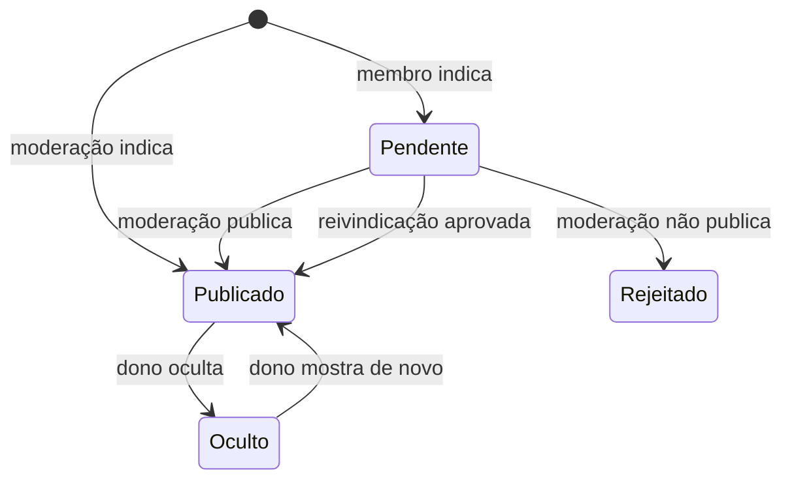
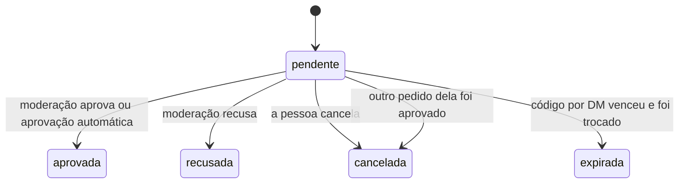

# Regras de negócio

Este documento descreve como o Negócio do Bem funciona hoje, regra por regra, do jeito que está no código. Serve para quem vai colaborar entender o que o sistema faz, por que faz e onde cada regra mora antes de mudar alguma coisa.

O código é a fonte da verdade. Se o código e este documento discordarem, um dos dois está errado: corrija no mesmo pull request. Mudou uma regra? Atualize este arquivo junto.

O raciocínio por trás das decisões e a história do projeto estão em [Como o projeto foi feito](como-foi-feito.md).

## Sumário

1. [Glossário](#1-glossário)
2. [Contas e papéis](#2-contas-e-papéis)
3. [O negócio: identidade, dados e estados](#3-o-negócio-identidade-dados-e-estados)
4. [Indicação](#4-indicação)
5. [Moderação das indicações](#5-moderação-das-indicações)
6. [Reivindicação: como o dono assume o perfil](#6-reivindicação-como-o-dono-assume-o-perfil)
7. [Perfil público e painel do dono](#7-perfil-público-e-painel-do-dono)
8. [História do negócio](#8-história-do-negócio)
9. [Fotos](#9-fotos)
10. [Depoimentos e denúncias](#10-depoimentos-e-denúncias)
11. [Diretório e busca](#11-diretório-e-busca)
12. [Causas, categorias e estados do Brasil](#12-causas-categorias-e-estados-do-brasil)
13. [Auditoria](#13-auditoria)
14. [Privacidade: o que guardamos e quem vê](#14-privacidade-o-que-guardamos-e-quem-vê)
15. [Números e limites](#15-números-e-limites)
16. [Comportamentos atuais que valem conhecer](#16-comportamentos-atuais-que-valem-conhecer)

---

## 1. Glossário

| Termo | No código | O que é |
| --- | --- | --- |
| Negócio | `Empresa` | Um negócio do diretório. Cada um é identificado pelo @ do Instagram. |
| Conta | `Usuario` | Quem se cadastrou com e-mail e senha. |
| Dono | `EmpresaMembro` com `papel = "dono"` | Uma conta que a moderação aprovou como responsável por um negócio. Um negócio pode ter mais de um dono (co-donos). |
| Moderação | `Usuario.papel = "moderador"` ou e-mail em `ADMIN_EMAILS` | Quem aprova indicações e reivindicações, decide denúncias e pode editar qualquer perfil. |
| Indicação | criação de uma `Empresa` | Alguém da comunidade (ou o próprio dono) cadastra um negócio. |
| Reivindicação | `Reivindicacao` | O pedido de uma pessoa para virar dona de um negócio. |
| Depoimento | `Depoimento` | O relato de alguém da comunidade sobre um negócio. |
| Denúncia | campos `denunciado`, `motivoDenuncia` e `denunciadoPorId` do `Depoimento` | O aviso de que um depoimento tem algo errado. |
| Causa | `EmpresaCausa` + lista em `src/lib/causas.ts` | Um valor que o negócio pratica, como "Escala 5x2" ou "Antirracista". Vira selo no perfil e filtro na busca. |
| Auditoria | `RegistroAuditoria` | O registro de quem fez o quê nas ações importantes. |

Os status são texto, e não `enum` do banco, para o esquema ser simples de evoluir. Os valores aceitos estão comentados em `prisma/schema.prisma` e os rótulos em `src/lib/dominio.ts`.

---

## 2. Contas e papéis

### Cadastro e login

Código: `src/acoes/conta.ts`, `src/lib/auth/`.

- **Cadastro** (`/cadastrar`):
  - nome de 2 a 80 caracteres;
  - e-mail válido de até 200 caracteres, guardado em minúsculas;
  - senha de 8 a 200 caracteres.
- **Um e-mail, uma conta.** O cadastro avisa quando o e-mail já existe ("Que tal entrar?").
- **Login** (`/entrar`): e-mail e senha.
  - O erro é sempre o mesmo, "E-mail ou senha incorretos".
  - Quando o e-mail não existe, a senha é conferida contra um hash falso, para a resposta levar o mesmo tempo e não revelar quais e-mails têm conta.
- **Senha:**
  - guardada com scrypt (N=2^15, r=8, p=1, sal aleatório de 16 bytes) no formato `scrypt$N$r$p$sal$hash`;
  - a comparação é em tempo constante.
- **Sessão:**
  - dura 30 dias;
  - o cookie `ndb_sessao` é `httpOnly`, `sameSite=lax` e `secure` em produção, e guarda um token aleatório;
  - o banco guarda só o SHA-256 do token, então quem lê o banco não consegue se passar pela pessoa;
  - "Sair" apaga a sessão do banco e o cookie.
- **Volta para onde a pessoa estava:**
  - páginas que exigem login mandam para `/entrar?voltar=<caminho>`;
  - o `voltar` só aceita caminhos internos (`caminhoSeguro`), para não virar um redirecionamento para outro site.

### Papéis

Um papel não exclui o outro: uma pessoa da moderação também pode ser dona de um negócio.

| Papel | Quem é | O que pode fazer |
| --- | --- | --- |
| **Visitante** | Sem login | Ver o diretório, os perfis publicados e os depoimentos. Não indica, não escreve depoimento, não reivindica. |
| **Membro** | Qualquer conta | Indicar negócios, escrever depoimentos, denunciar depoimentos, reivindicar um negócio, ver as próprias indicações e solicitações em `/painel`. |
| **Dono** | Conta aprovada como dona de um negócio | Tudo do membro, mais: editar o perfil do próprio negócio, trocar a foto, responder depoimentos e ocultar ou mostrar o negócio no diretório. Não pode escrever depoimento no próprio negócio. |
| **Moderação** | `papel = "moderador"` no banco **ou** e-mail em `ADMIN_EMAILS` | Tudo do membro, mais: as filas de `/moderacao`, editar qualquer perfil, ver a auditoria. Indicações feitas pela moderação já entram publicadas. |

Detalhes da moderação:

- `ADMIN_EMAILS` é conferido a cada requisição e não grava nada no banco. Tirar o e-mail da variável tira o acesso.
- Para quem não é moderação, `/moderacao` e `/moderacao/negocios/<@>` respondem 404: a área simplesmente não existe.
- A moderação **não** responde depoimentos nem oculta negócios dos outros. Isso é só do dono.

---

## 3. O negócio: identidade, dados e estados

### Identidade: o @ do Instagram

Código: `normalizarUsername` em `src/lib/instagram.ts`.

- Todo negócio é identificado pelo **@ do Instagram**, que também é o endereço da página: `/empresas/<@>`.
- O @ é **único**: não existem dois negócios com o mesmo @.
- O @ é normalizado antes de guardar e de comparar:
  - aceita `@fulano`, `fulano` ou o link do perfil (`instagram.com/fulano`);
  - guarda em minúsculas e sem `@`;
  - só letras, números, `.` e `_`, até 30 caracteres;
  - não pode começar nem terminar com `.`, nem ter `..`;
  - recusa caminhos do Instagram que não são perfis (`p`, `reel`, `reels`, `explore`, `stories`, `accounts`, `direct`, `tv`).
- **Ninguém muda o @ depois** (nem o dono, nem a moderação). Não existe tela para isso.
- Além do @, o negócio pode guardar dois IDs fixos do Instagram (`instagramUserId` e `instagramIgsid`). Eles só são preenchidos pelos caminhos de verificação pelo Instagram, hoje desligados (ver [seção 6](#caminhos-pelo-instagram-desligados-por-padrão)).

### Dados do negócio

Validação: `src/acoes/empresas.ts` e `src/lib/formulario.ts`.

| Campo | Obrigatório | Regra |
| --- | --- | --- |
| Nome | Sim | 2 a 80 caracteres. |
| Categoria | Sim | Uma da lista fixa (ver [seção 12](#categorias)). |
| Cidade | Sim | 2 a 60 caracteres. Texto livre. |
| Estado (UF) | Sim | Uma das 27 siglas. |
| Resumo ("em uma frase") | Sim | 10 a 160 caracteres. Aparece nos cards do diretório. |
| Site | Não | Até 200 caracteres. Sem `http`, ganha `https://`. Precisa ter um ponto no domínio. |
| WhatsApp | Não | Número brasileiro com DDD (ver abaixo). |
| E-mail de contato | Não | E-mail válido, até 200 caracteres, guardado em minúsculas. |
| Causas | Não | Qualquer combinação da lista oficial. Slugs desconhecidos são descartados. |
| História | Não | Markdown, até 20 mil caracteres (ver [seção 8](#8-história-do-negócio)). |
| Foto | Não | Ver [seção 9](#9-fotos). |

**Regras do WhatsApp:**

- Aceita `(11) 99148-8052`, `11 99148-8052`, `+55 11 99148-8052`, com ou sem zero na frente.
- Guarda **só os dígitos, com o 55 do Brasil** (`5511991488052`).
- O DDD não pode ter zero.
- Depois do DDD vem um celular (9 e mais 8 dígitos) ou um fixo (começa com 2, 3, 4 ou 5 e tem 8 dígitos).
- Números estrangeiros são recusados.
- No perfil, o número aparece formatado, e o botão abre `wa.me/<número>`.

### Três estados independentes

O negócio tem três informações de estado que andam separadas:

| Campo | Valores | O que significa |
| --- | --- | --- |
| `moderacao` | `pendente` · `aprovada` · `rejeitada` | Se a moderação já liberou o negócio. Só `aprovada` pode aparecer no diretório. |
| `status` | `indicada` · `verificada` | Se tem dono aprovado. Vira `verificada` quando a primeira reivindicação é aprovada e não volta mais. |
| `oculta` | `false` · `true` | Se o dono tirou o negócio do diretório. |

**Um negócio aparece para o público quando `moderacao = "aprovada"` e `oculta = false`.** Fora disso, só o dono, a moderação e quem indicou veem o perfil (ver [seção 7](#quem-vê-um-perfil-que-não-está-no-diretório)).

| Transição | Quem faz | Onde |
| --- | --- | --- |
| Indicação de um membro → `pendente` | Qualquer conta | `indicarEmpresa` |
| Indicação da moderação → `aprovada` | Moderação | `indicarEmpresa` |
| `pendente` → `aprovada` ou `rejeitada` | Moderação, na fila de indicações | `moderarEmpresa` |
| Qualquer → `aprovada` e `verificada` | Aprovação de uma reivindicação | `aprovar` em `src/lib/reivindicacao.ts` |
| `oculta` liga e desliga | Só o dono | `alternarVisibilidade` |

Repare: aprovar uma reivindicação **também publica** o negócio. É assim que o dono que cadastra o próprio negócio entra no diretório: a moderação aprova o pedido dele e, junto, o perfil.

---

## 4. Indicação

Código: `indicarEmpresa` em `src/acoes/empresas.ts`, tela em `src/app/indicar/`.

- **Precisa de login.** Sem conta, a página `/indicar` pede para entrar ou criar uma conta.
- **Dados pedidos:** @ do Instagram, nome, categoria, cidade, UF e resumo, que são obrigatórios. Site, WhatsApp, e-mail, causas e "por que você indica" são opcionais.
- **O @ não pode já estar cadastrado.** Se já existe um negócio com aquele @, em qualquer estado (inclusive pendente ou rejeitado), a indicação é recusada com um link para o perfil.
- **Motivo da indicação:** até 600 caracteres, opcional. Aparece no perfil, com o nome de quem indicou, até o dono escrever a história.
- **Causas:** a tela pede para marcar "só o que você sabe que é verdade". O dono ajusta depois.
- **Limite:** cada conta faz no máximo **10 indicações em 24 horas**. Conta todo negócio criado por ela no período.
- **Resultado:**
  - indicação de um membro: o negócio entra como `pendente` e `indicada`, e a pessoa volta para o perfil com o aviso "O perfil entra no diretório assim que a moderação aprovar";
  - indicação da moderação: o negócio já entra `aprovada`.
- **Auditoria:** registra `empresa.indicada`.

### "Este negócio é meu"

Quando a pessoa marca **"Este negócio é meu"** no formulário de indicação:

- o campo "Por que você indica?" some e o motivo não é guardado;
- o negócio é criado do mesmo jeito, `pendente`, com a pessoa como quem indicou;
- a pessoa vai direto para a página de reivindicação (`/empresas/<@>/reivindicar`) para enviar os dados do negócio.

Marcar a opção não faz ninguém virar dono. A pessoa só vira dona quando a moderação aprovar a reivindicação.

---

## 5. Moderação das indicações

Código: `moderarEmpresa` em `src/acoes/moderacao.ts`, aba "Indicações" em `src/app/moderacao/page.tsx`.

- **A fila "Indicações"** mostra os negócios com `moderacao = "pendente"`, dos mais antigos para os mais novos, até 50 por vez.
- **Cada item mostra:**
  - nome, @ (com link para o Instagram), categoria, cidade e UF, resumo;
  - motivo da indicação;
  - contatos sugeridos e causas;
  - quem indicou (nome) e quando.
- **Decisões:**
  - **Publicar** → `moderacao = "aprovada"`, e o negócio entra no diretório;
  - **Não publicar** → `moderacao = "rejeitada"`, e o negócio some para o público.
  - **Editar perfil** → abre a edição pela moderação antes de decidir, por exemplo para corrigir um nome ou tirar uma causa duvidosa.
- **Auditoria:** registra `empresa.aprovada` ou `empresa.rejeitada`.
- **O que muda num negócio rejeitado:**
  - o @ continua ocupado, então ninguém consegue indicar de novo;
  - a página de reivindicação responde 404.

### Editar qualquer perfil

Código: aba "Negócios" e `src/app/moderacao/negocios/[usuario]/page.tsx`.

- **A aba "Negócios"** lista todos os negócios, publicados, pendentes, rejeitados e ocultos, com foto, cidade, situação na moderação e se tem dono.
  - A busca usa os mesmos campos da busca do diretório.
  - Sem busca, a lista mostra os 50 atualizados mais recentemente.
- **Edição:** `/moderacao/negocios/<@>` usa o **mesmo formulário do painel do dono**: foto, informações, contatos, causas e história.
  - Um aviso lembra que a edição é pela moderação e que fica registrada.
  - Se o negócio tem dono, o aviso pede para mudar só o necessário.
- **No perfil público,** quem é da moderação (e não é dono) vê o botão **"Editar perfil (moderação)"**.
- **Na auditoria,** toda edição da moderação ganha o sufixo `_pela_moderacao`. Exemplos: `empresa.editada_pela_moderacao`, `empresa.foto_trocada_pela_moderacao`.

---

## 6. Reivindicação: como o dono assume o perfil

Código: regras em `src/lib/reivindicacao.ts` (com testes em `tests/db/reivindicacao.test.ts`), ações em `src/acoes/reivindicacoes.ts` e `src/acoes/moderacao.ts`, tela em `src/app/empresas/[usuario]/reivindicar/page.tsx`.

### Quem pode pedir

- **Qualquer conta logada** que ainda não seja dona daquele negócio. Quem já é dono vê "Você já é dono deste perfil" e o link para o painel.
- A página fica em **`/empresas/<@>/reivindicar`**. Chega-se nela pelo botão **"Sou o dono"** do perfil, pelo "Este negócio é meu" da indicação ou pelo link "Este perfil é seu e outra pessoa assumiu? Fale com a moderação" dos perfis verificados.
- **Negócio rejeitado:** a página responde 404.
- **Negócio que já tem dono:** o pedido é aceito, com um aviso de que vai para a moderação. Serve para co-donos e para troca de responsáveis.

### O caminho ativo: dados do negócio (`documento`)

Hoje é o único caminho ligado. A pessoa envia:

| Campo | Obrigatório | Regra |
| --- | --- | --- |
| Relação com o negócio | Sim | 2 a 120 caracteres (ex.: "sou a dona", "cuido das redes"). |
| Contato | Sim | 5 a 160 caracteres. WhatsApp ou e-mail para a moderação falar com a pessoa. |
| CNPJ ou MEI | Não | Validado pelos dígitos verificadores, inclusive no formato alfanumérico que a Receita passou a emitir em julho de 2026. Guardado sem pontuação. |
| Site | Não | Mesma regra do site do negócio. |
| Mensagem | Não | Até 1.000 caracteres. |

O @ do Instagram não é pedido: é o do próprio perfil.

**Regras do pedido:**

- **Um pedido em análise por vez:**
  - cada pessoa só pode ter **um** pedido por dados do negócio pendente para o mesmo negócio;
  - enquanto ele está em análise, o formulário dá lugar ao aviso "Seus dados estão com a moderação".
- **Limite:**
  - no máximo **10 pedidos de reivindicação em 24 horas** por conta, somando todos os caminhos e todos os negócios;
  - pedidos cancelados também contam.
- **Cancelar:** a pessoa pode cancelar o próprio pedido pendente na página de reivindicação.
- **Validade:**
  - o pedido guarda uma data de validade de 30 dias, que a moderação vê como "expirado em";
  - ela é **só informativa**: a moderação ainda consegue aprovar ou recusar depois disso.

### A decisão da moderação

Na aba "Reivindicações" (`/moderacao?aba=reivindicacoes`), todos os pedidos pendentes aparecem dos mais antigos para os mais novos, até 50 por vez. Cada um mostra:

- o negócio, o @ (com link para o Instagram) e se já é verificado ou está sem dono;
- o caminho usado, a data do pedido e, se for o caso, a data em que expirou;
- quem pediu: nome e e-mail;
- no pedido por dados do negócio:
  - relação, contato, CNPJ formatado e site;
  - a mensagem;
  - **os dados da Receita para o CNPJ** (razão social, nome fantasia, situação cadastral, município e UF), consultados na BrasilAPI na hora. A consulta é só um apoio: se falhar, aparece "Não foi possível consultar a Receita agora" e a análise segue;
- as anotações automáticas do sistema, quando houver;
- os donos atuais (nome e e-mail), quando houver.

O que a moderação confere: se o CNPJ, o site e o contato batem com o @ do Instagram. Em caso de dúvida, fala com a pessoa pelo contato informado.

**Botões:**

| Situação | Botões | Efeito |
| --- | --- | --- |
| Negócio sem dono | **Aprovar** | A pessoa vira dona. |
| Negócio com dono | **Aprovar como co-dono** | A pessoa vira dona junto com os atuais. |
| Negócio com dono | **Aprovar e transferir** | A pessoa vira dona e **os outros donos deixam de ser**. |
| Qualquer | **Recusar** (com motivo) | O pedido é recusado. O motivo tem até 500 caracteres e **a pessoa vê no painel dela**. Sem motivo, fica "Não foi possível confirmar que você controla este negócio." |

**O que a aprovação faz,** tudo numa transação só:

1. Cria o vínculo de dono (ou mantém, se já existia).
2. No modo "transferir", remove todos os outros donos.
3. Marca o negócio como `verificada` e `aprovada`, o que também o publica.
4. Liga os IDs do Instagram ao negócio, se o pedido trouxe algum. Se a mesma conta do Instagram estava ligada a outro perfil, a ligação sai de lá.
5. Marca o pedido como `aprovada`, com quem aprovou e quando.
6. Cancela os **outros pedidos pendentes da mesma pessoa** para o mesmo negócio. Pedidos de **outras pessoas** para o mesmo negócio continuam pendentes, e a moderação decide cada um.
7. Registra na auditoria `reivindicacao.aprovada` ou `reivindicacao.aprovada_com_transferencia`.

**Duas pessoas da moderação ao mesmo tempo:** se um pedido já foi decidido, a segunda decisão é recusada com o aviso "Esta solicitação já tinha sido decidida por outra pessoa da moderação".

**Depois da decisão,** a pessoa acompanha em `/painel`, em "Minhas solicitações de reivindicação". Aparecem as 20 mais recentes, menos as canceladas, com o status e, se recusada, o motivo.

### Estados de um pedido

| Status | Rótulo na tela | Quando |
| --- | --- | --- |
| `pendente` | Em análise | Pedido criado e ainda não decidido. |
| `aprovada` | Aprovada | Pela moderação, ou sozinho nos caminhos pelo Instagram, quando não há conflito. |
| `recusada` | Recusada | Pela moderação, com motivo. |
| `cancelada` | Cancelada | A pessoa cancelou, outro pedido dela para o mesmo negócio foi aprovado, ou ela refez o "Entrar com Instagram". |
| `expirada` | Expirada | Só no código por DM: quando a pessoa gera um código novo depois que o anterior venceu. |

### Caminhos pelo Instagram (desligados por padrão)

Os dois caminhos abaixo estão prontos no código e testados, mas ficam **desligados** enquanto as variáveis de ambiente estiverem vazias. Quando algum está ligado, o envio de dados vira a opção "Não tenho acesso ao Instagram do negócio". Como ligar está no [README](../README.md#ativando-o-código-por-dm-opcional).

| Caminho | Liga quando | Aprovação |
| --- | --- | --- |
| **Entrar com Instagram** (`instagram_login`) | `INSTAGRAM_APP_ID`, `INSTAGRAM_APP_SECRET` e `APP_URL` preenchidos | Na hora, se a conta conectada é a do negócio e não há conflito |
| **Código por DM** (`codigo_dm`) | `INSTAGRAM_PERFIL_OFICIAL` preenchido | Pela moderação, ou sozinho se o webhook estiver configurado e não houver conflito |

**A regra de ouro: não existe aprovação automática quando há conflito.** Em `conflitosDeVerificacao`, um conflito é qualquer uma destas situações:

1. O negócio já tem outro dono.
2. A conta do Instagram é diferente da registrada antes no negócio (o @ pode ter mudado de dono).
3. A conta do Instagram já está ligada a **outro** perfil do diretório (talvez o negócio tenha trocado de @).

Com conflito, o pedido fica pendente com uma anotação explicando o que aconteceu, e a moderação decide.

O perfil fica ligado ao **ID fixo da conta** do Instagram, não só ao @, porque um @ pode ser abandonado e registrado por outra pessoa.

**Entrar com Instagram:**

- **Pedido de login:**
  - pede só a permissão `instagram_business_basic`, que dá o ID e o @ da conta, e nada de publicar ou ler mensagens;
  - força a pessoa a escolher a conta de novo (`force_reauth`), para ela não entrar sem querer com a conta pessoal;
  - funciona só com contas comerciais ou de criador de conteúdo.
- **Proteção do retorno:** um `state` aleatório fica num cookie de 10 minutos e precisa voltar igual do Instagram. Isso impede que alguém force o retorno do login de outra pessoa para dentro da sua conta.
- **O token não é guardado.** Ele só serve para perguntar ao Instagram qual conta autorizou.
- **Resultado:**
  - conta conectada diferente do @ do negócio: aviso de erro, e nada é criado;
  - a pessoa já é dona: tudo certo;
  - caso contrário: aplica o limite diário, cancela tentativas anteriores pelo mesmo caminho, cria o pedido e aprova na hora se não houver conflito.

**Código por DM:**

- **O código:**
  - tem o formato `BEM-XXXXXX`, com 6 caracteres de um alfabeto sem os parecidos (`0/O`, `1/I/L`);
  - vale **48 horas**;
  - enquanto vale, a mesma pessoa recebe o mesmo código para o mesmo negócio;
  - vencido, ele vira `expirada` e outro é gerado.
- **Quem vira dono é quem gerou o código.** A tela avisa: "Nunca envie um código que outra pessoa te passou".
- **A DM precisa vir do @ do negócio** e ir para o perfil oficial.
  - O sistema reconhece o código mesmo escrito como `bem 7k3f9q` ou `BEM7K3F9Q`.
- **Sem webhook:** a moderação confere a DM. Na fila, há uma busca pelo código.
- **Com webhook:**
  - o sistema confere a assinatura `X-Hub-Signature-256` de cada chamada da Meta e descobre o @ de quem mandou;
  - aprova sozinho só se o @ bater e não houver conflito;
  - código vencido, @ diferente ou @ que não deu para descobrir viram anotações para a moderação;
  - se der erro, a rota responde 500 e a Meta tenta de novo;
  - aprovações automáticas aparecem na auditoria como "sistema".

---

## 7. Perfil público e painel do dono

### O que o perfil mostra

Código: `src/app/empresas/[usuario]/page.tsx`.

- **Foto ou monograma.** Sem foto, aparecem as iniciais do nome com uma cor que é sempre a mesma para cada @.
- **Selo:**
  - **"Verificado pelo dono"** quando `status = "verificada"`;
  - **"Indicado pela comunidade"** quando ainda não tem dono.
- **Nome, @** (com link para o Instagram), **categoria, cidade e UF.**
- **Botões de contato** (só os preenchidos):
  - WhatsApp, que abre `wa.me`;
  - site, que mostra o domínio sem `www`;
  - e-mail, que abre `mailto:`.
- **Resumo** e **causas** como selos.
- **"Nossa história",** com "N min de leitura · atualizada em …". Sem história:
  - para o dono, um convite para escrever;
  - para os outros, o motivo da indicação e o nome de quem indicou, se houver;
  - senão, "A história deste negócio ainda vai ser contada."
- **"Este negócio é seu? Sou o dono",** se o negócio ainda não é verificado e quem vê não é dono.
- **Depoimentos** (ver [seção 10](#10-depoimentos-e-denúncias)).
- **"Este perfil é seu e outra pessoa assumiu? Fale com a moderação",** se o negócio é verificado e quem vê não é dono. O link leva à página de reivindicação.

**Botões de edição:**

- o dono vê **"Editar meu perfil"**;
- a moderação que não é dona vê **"Editar perfil (moderação)"**.

### Quem vê um perfil que não está no diretório

Código: `podeVerPerfil` em `src/lib/consultas.ts`.

Perfil pendente, rejeitado ou oculto só abre para:

- a moderação;
- os donos;
- quem indicou.

Para todo o resto, a página responde 404. Quem pode ver encontra um aviso no topo:

- **pendente:** "Aguardando moderação: só você e a moderação veem este perfil por enquanto.";
- **rejeitado:** a mesma frase, começando com "Não publicada";
- **oculto:** "Este perfil está oculto pelo dono e não aparece no diretório."

### Painel do dono

Código: `src/app/painel/`.

- **`/painel`** mostra:
  - os negócios de que a pessoa é dona, com avisos de "Oculto do diretório" e "Falta contar a história";
  - as solicitações de reivindicação;
  - as indicações dela, com a situação de cada uma na moderação.
- **`/painel/<@>`** só abre para os donos daquele negócio (os outros recebem 404). Nele, o dono:
  - **edita o perfil:** foto, informações, contatos, causas e história. O @ não muda;
  - **responde depoimentos:** até 1.000 caracteres. A resposta pode ser trocada a qualquer momento, e apagar o texto tira a resposta;
  - **oculta ou mostra o negócio no diretório.**

**Ocultar o negócio:**

- Só o dono pode, a qualquer momento.
- O negócio sai do diretório e o perfil some para o público (404).
- Enquanto oculto, ninguém deixa depoimento.
- O perfil fica guardado, e o dono pode voltar a mostrar quando quiser.
- É a resposta para "meu negócio foi indicado e eu não quero aparecer": a pessoa reivindica o perfil e oculta.
- **Auditoria:** registra `empresa.ocultada` e `empresa.reexibida`.

**Toda edição** atualiza o texto de busca do negócio e fica na auditoria (`empresa.editada`, `empresa.foto_trocada`, `empresa.foto_removida`).

---

## 8. História do negócio

Código: editor em `src/components/EditorHistoria.tsx`, exibição em `src/components/Historia.tsx`.

- **É guardada em Markdown,** até 20 mil caracteres.
- **O editor é visual, no estilo Substack** (Tiptap). Ele lê e grava Markdown, então só oferece o que o Markdown guarda:
  - parágrafo, título e subtítulo;
  - negrito, itálico, tachado e link;
  - citação, lista, lista numerada e separador (✦);
  - foto com legenda;
  - desfazer e refazer.
  - Não tem sublinhado, cores nem código.
- **Pré-visualização:** uma aba mostra o texto exatamente como vai aparecer no perfil.
- **Tempo de leitura:**
  - conta as palavras a 200 por minuto, arredondado, com no mínimo 1 minuto;
  - ignora a marcação e os endereços de fotos e links.
- **Exibição segura:**
  - HTML escrito no texto não é executado (o `react-markdown` ignora HTML cru), então ninguém injeta scripts;
  - títulos de nível 1 viram nível 2, porque o nome do negócio já é o título da página;
  - links abrem em outra aba com `rel="nofollow ugc noopener noreferrer"`;
  - **só aparecem fotos enviadas pelo próprio site.** Imagens de outros endereços são ignoradas no perfil e aparecem no editor com um aviso para trocar.
- **Legenda:** o texto alternativo da imagem vira a legenda, centralizada embaixo da foto. No editor, colchetes e quebras de linha são removidos da legenda para não quebrar o Markdown.

---

## 9. Fotos

Código: `src/lib/fotos.ts`, `src/lib/armazenamento.ts`, `src/components/reduzirFoto.ts`.

**Quem envia:**

- **Foto do perfil:** o dono ou a moderação. Trocar ou remover apaga a foto antiga do armazenamento.
- **Foto da história:** o dono ou a moderação, pelo botão "Foto" do editor. Ela é guardada na hora e entra no texto onde está o cursor.

**No navegador, antes de enviar:**

- A foto do perfil é recortada no centro, em quadrado, e reduzida a 600×600.
- A foto da história é reduzida até 1.600 px no lado maior.
- Todas saem em JPEG (qualidade 0,85), com fundo branco onde havia transparência.

**No servidor:**

- Limite de **3 MB por foto**. O limite de envio das Server Actions é 4 MB (`next.config.ts`), e o do Vercel é 4,5 MB.
- O tipo é conferido **pelos primeiros bytes do arquivo** (JPEG, PNG ou WebP), não pelo que o navegador diz.
- O nome do arquivo é aleatório, nas pastas `perfis/` ou `historias/`.
- Onde a foto fica:
  - em produção, no **Vercel Blob**, com acesso público;
  - no computador de quem desenvolve, sem `BLOB_READ_WRITE_TOKEN`, em `public/enviados/`, fora do Git;
  - em produção sem o token, a pessoa vê uma mensagem de erro em vez de o site quebrar.

**O site só mostra fotos guardadas por ele mesmo** (`ehFotoDoSite`): endereços do Vercel Blob ou da pasta `/enviados/`. Uma imagem de outro endereço avisaria aquele servidor a cada visita ao perfil, então ela simplesmente não aparece.

---

## 10. Depoimentos e denúncias

Código: `src/acoes/depoimentos.ts`, `decidirDenuncia` em `src/acoes/moderacao.ts`.

### Depoimentos

- **Precisa de login.**
- Só em negócios **publicados e não ocultos.**
- **Donos não escrevem depoimento no próprio negócio.** Eles respondem.
- **Um depoimento por pessoa por negócio.**
- **Tamanho:** de 20 a 1.500 caracteres.
- **Vai ao ar na hora,** sem moderação prévia, com o nome de quem escreveu e a data.
- **Ordem:** os depoimentos aparecem do mais novo para o mais antigo.
- **Edição:** o autor não edita nem apaga o próprio depoimento. Não existe tela para isso.
- **Resposta do dono:**
  - aparece embaixo do depoimento como "Resposta de <negócio>";
  - **donos não apagam depoimentos.** O painel explica: se algum for ofensivo, o caminho é denunciar.
- **Nos cards do diretório,** aparece a contagem de depoimentos publicados.

### Denúncias

- **Quem denuncia:** qualquer pessoa logada que **não seja a autora** do depoimento, incluindo o dono do negócio.
- **Motivo:** opcional, até 300 caracteres. Sem motivo, fica "Sem motivo informado".
- **Denunciar não esconde o depoimento.** Ele continua no ar até a moderação decidir.
- **Uma denúncia aberta por vez:**
  - enquanto há uma denúncia aberta, o botão "Denunciar" some para todos;
  - uma segunda denúncia não substitui a primeira.
- **A fila "Denúncias"** mostra:
  - o negócio;
  - o autor do depoimento (nome e e-mail) e a data;
  - o texto;
  - quem denunciou e o motivo.
- **Decisões:**
  - **Manter no ar:** limpa a denúncia, e o depoimento pode ser denunciado de novo no futuro. Registra `depoimento.mantido`.
  - **Remover:** o depoimento passa a `removido` e sai do site. Registra `depoimento.removido`. Não existe botão para desfazer.

---

## 11. Diretório e busca

Código: `lerFiltros` e `listarEmpresas` em `src/lib/consultas.ts`, página `src/app/page.tsx`.

- **Quem aparece:** só negócios com `moderacao = "aprovada"` e `oculta = false`.
- **Ordem:**
  - primeiro os **verificados pelo dono**;
  - depois, dentro de cada grupo, os atualizados mais recentemente.
  - Não existe ranking por nota nem anúncio pago.
- **Busca por texto:**
  - procura no nome, no resumo, na categoria, na cidade, na UF e no @;
  - **não** procura na história nem nas causas, que têm filtro próprio;
  - é feita sobre o campo `busca`, que guarda esses textos em minúsculas e sem acento e é atualizado a cada indicação e edição;
  - por isso, "sao paulo" encontra "São Paulo";
  - cada palavra digitada precisa aparecer, e só valem as 6 primeiras palavras e os 100 primeiros caracteres.
- **Filtro por estado:** uma UF, ou "Todo o Brasil".
- **Filtro por causas:**
  - quem clica em várias causas vê os negócios que têm **todas** elas;
  - a causa ativa fica destacada, e clicar de novo tira o filtro.
- **Paginação:** 18 negócios por página, até a página 500. Os botões são "← Anteriores" e "Mais negócios →".
- **Os filtros ficam na URL** (`?q=…&uf=…&causa=…&pagina=…`), então dá para compartilhar uma busca.

---

## 12. Causas, categorias e estados do Brasil

### Causas

Código: `src/lib/causas.ts`.

A lista é fixa no código, em três grupos:

| Grupo | Causas (slug) |
| --- | --- |
| **Trabalho digno** | Escala 5x2 (`escala-5x2`), Escala 4x3 (`escala-4x3`), Remuneração justa (`remuneracao-justa`), Contrata pessoas 50+ (`contrata-50-mais`) |
| **Diversidade e respeito** | Antirracista (`antirracista`), Afroempreendedor (`afroempreendedor`), LGBTQIA+ friendly (`lgbtqia`), Liderado por mulheres (`liderado-por-mulheres`), Acessível (`acessivel`), Empreendimento indígena (`indigena`) |
| **Comunidade e planeta** | Pet friendly (`pet-friendly`), Sustentável (`sustentavel`), Opções veganas (`opcoes-veganas`), Agricultura familiar (`agricultura-familiar`), Negócio de bairro (`negocio-de-bairro`), Apoia projetos sociais (`apoia-projetos-sociais`), Economia solidária (`economia-solidaria`) |

Cada causa tem nome, emoji, descrição e grupo. A página "Como funciona" lista todas com a descrição.

Regras:

- **Quem marca as causas:** quem indica, o dono e a moderação. É autodeclarado: ninguém confere se o negócio pratica a causa. Quem indica é orientado a marcar só o que sabe que é verdade, e o dono, só o que vive no dia a dia.
- **Ordem:** os selos aparecem sempre na ordem da lista oficial.
- **Nos cards do diretório,** aparecem até 3 selos e um "+N" para o resto.
- **Para criar uma causa,** basta acrescentá-la à lista. O banco guarda só o slug.
- **Trocar o slug de uma causa existente** exige uma migração que atualize as linhas de `EmpresaCausa`. Sem isso, os negócios perdem a causa na tela (os slugs desconhecidos são descartados ao exibir), mas as linhas continuam no banco.

### Categorias

Código: `src/lib/dominio.ts`.

Os valores aceitos são estes 16, e um negócio tem uma categoria só:

- Alimentação; Café e padaria; Restaurante e bar; Mercado e empório
- Moda e acessórios; Beleza e bem-estar; Saúde
- Educação; Arte e cultura; Livraria e papelaria
- Casa e decoração; Pet
- Serviços; Tecnologia; Turismo e hospedagem; Outros

A categoria é guardada como texto. Renomear uma categoria exige atualizar os negócios que já a usam.

### Estados

As 27 UFs do Brasil. Só negócios brasileiros por enquanto: a UF é obrigatória e o WhatsApp só aceita números do Brasil.

---

## 13. Auditoria

Código: `src/lib/auditoria.ts`.

Toda decisão e edição importante grava quem fez, o quê, em qual alvo e quando. A aba "Auditoria" mostra os 100 registros mais recentes. "Sistema" aparece quando a ação foi automática, por exemplo uma aprovação pelo webhook.

| Ação registrada | Quando |
| --- | --- |
| `empresa.indicada` | Alguém indicou um negócio. |
| `empresa.aprovada` / `empresa.rejeitada` | A moderação publicou ou não publicou uma indicação. |
| `empresa.editada` | O dono salvou o perfil. |
| `empresa.foto_trocada` / `empresa.foto_removida` | O dono trocou ou removeu a foto do perfil. |
| `empresa.editada_pela_moderacao`, `empresa.foto_trocada_pela_moderacao`, `empresa.foto_removida_pela_moderacao` | As mesmas, feitas pela moderação. Os detalhes trazem o @. |
| `empresa.ocultada` / `empresa.reexibida` | O dono tirou ou devolveu o negócio ao diretório. |
| `reivindicacao.aprovada` / `reivindicacao.aprovada_com_transferencia` | Um pedido foi aprovado, como co-dono ou com transferência. Os detalhes trazem o pedido, o caminho e a pessoa. |
| `reivindicacao.recusada` | Um pedido foi recusado. Os detalhes trazem o motivo. |
| `depoimento.mantido` / `depoimento.removido` | A moderação decidiu uma denúncia. |

O que **não** vai para a auditoria hoje:

- cadastro, login e saída;
- criação e cancelamento de pedidos de reivindicação (eles ficam na própria tabela de reivindicações);
- depoimentos, respostas e denúncias;
- envio de fotos da história.

Para uma ação nova de moderação, registre sempre na auditoria.

---

## 14. Privacidade: o que guardamos e quem vê

### O que é guardado

| Dado | Onde | Quem vê |
| --- | --- | --- |
| Nome da conta | `Usuario` | **Público** quando a pessoa escreve um depoimento ou quando a indicação dela aparece no perfil ("indicado por …"). A moderação vê nas filas. |
| E-mail da conta | `Usuario` | Só a própria pessoa (no menu) e a moderação (de quem pede a reivindicação, dos donos atuais e de quem escreveu um depoimento denunciado). Nunca aparece no site público. |
| Senha | `Usuario.senhaHash` | Ninguém: só o hash scrypt é guardado. |
| Sessões | `Sessao` | Ninguém: só o hash do token. |
| Dados do perfil do negócio | `Empresa` | **Público** quando o negócio está publicado. |
| Dados do pedido de reivindicação (relação, contato, CNPJ, site, mensagem) | `Reivindicacao` | Só a moderação. A pessoa vê o status e o motivo da recusa. |
| Depoimentos | `Depoimento` | **Públicos**, com nome e data. |
| Quem denunciou e o motivo | `Depoimento` | Só a moderação. |
| Auditoria | `RegistroAuditoria` | Só a moderação. |

### O que não fazemos

- **Não raspamos o Instagram.** O @ é digitado por pessoas.
- **Não guardamos tokens do Instagram.** Nos caminhos pelo Instagram, guardamos só o ID da conta.
- **Não mostramos imagens de outros sites.** Elas avisariam esses servidores a cada visita.
- **Não temos ranking nem anúncio pago.**

### Medição de visitas

- O site usa o **Google Analytics 4**, só em produção: ele só carrega quando `NEXT_PUBLIC_GA_ID` está configurado, e essa variável só existe no ambiente Production do Vercel.
- A "medição otimizada" está ligada. Ela conta:
  - páginas vistas;
  - rolagem;
  - cliques para outros sites;
  - buscas no diretório (o parâmetro `q` da URL).
- O Analytics usa cookies e não recebe nome nem e-mail.
- Por decisão do projeto, o site não mostra aviso de cookies. A página "Como funciona" explica a medição na seção de privacidade.

### Proteções da interface

- **Avisos depois de uma ação** chegam pela URL como um código (`?aviso=salvo`). Só os códigos conhecidos em `src/lib/avisos.ts` viram texto: nada da URL é mostrado diretamente.
- **Os redirecionamentos depois do login** só aceitam caminhos internos.
- **Toda permissão é conferida no servidor,** dentro da Server Action, nunca só escondendo um botão. As funções que fazem isso:
  - `exigirUsuario`;
  - `exigirDono`;
  - `exigirEditor` (dono ou moderação);
  - `exigirModerador`.

---

## 15. Números e limites

| Regra | Valor | Onde |
| --- | --- | --- |
| Duração da sessão | 30 dias | `src/lib/auth/sessao.ts` |
| Senha | 8 a 200 caracteres | `src/acoes/conta.ts` |
| Indicações por conta | 10 a cada 24 horas | `src/acoes/empresas.ts` |
| Pedidos de reivindicação por conta | 10 a cada 24 horas | `src/lib/reivindicacao.ts` |
| Validade do código por DM | 48 horas | `src/lib/reivindicacao.ts` |
| Validade dos outros pedidos | 30 dias (informativa) | `src/lib/reivindicacao.ts` |
| Nome do negócio | 2 a 80 caracteres | `src/acoes/empresas.ts` |
| Resumo | 10 a 160 caracteres | `src/acoes/empresas.ts` |
| Motivo da indicação | até 600 caracteres | `src/acoes/empresas.ts` |
| História | até 20 mil caracteres | `src/acoes/empresas.ts` |
| Depoimento | 20 a 1.500 caracteres | `src/acoes/depoimentos.ts` |
| Resposta do dono | até 1.000 caracteres | `src/acoes/depoimentos.ts` |
| Motivo da denúncia | até 300 caracteres | `src/acoes/depoimentos.ts` |
| Motivo da recusa | até 500 caracteres | `src/acoes/moderacao.ts` |
| Mensagem da reivindicação | até 1.000 caracteres | `src/acoes/reivindicacoes.ts` |
| Foto | até 3 MB, JPEG, PNG ou WebP | `src/lib/fotos.ts` |
| Foto do perfil | 600×600, quadrada | `src/components/FormFoto.tsx` |
| Foto da história | até 1.600 px no lado maior | `src/components/EditorHistoria.tsx` |
| Negócios por página no diretório | 18 | `src/lib/consultas.ts` |
| Itens por fila da moderação | 50 | `src/app/moderacao/page.tsx` |
| Registros na aba de auditoria | 100 | `src/app/moderacao/page.tsx` |
| Leitura da história | 200 palavras por minuto | `src/lib/texto.ts` |

---

## 16. Comportamentos atuais que valem conhecer

O sistema funciona hoje assim. Algumas destas situações podem ser intencionais e outras são lacunas. Antes de mudar qualquer uma, abra uma issue para combinar o caminho.

**Negócios e moderação**

- A moderação não tem botão para **tirar do ar um negócio já publicado** nem para **rever uma indicação rejeitada**. Só o dono oculta.
- **Um @ rejeitado fica bloqueado:** ninguém consegue indicar de novo, e a página de reivindicação responde 404.
- **O @ de um negócio não muda.** Se o negócio trocar de @ no Instagram, hoje só dá para ajustar direto no banco.
- **Não dá para tirar um dono** sem transferir o perfil para outra pessoa. O selo "Verificado pelo dono" não volta atrás.
- "Atualizada em", ao lado da história, usa a data da última mudança em **qualquer** dado do negócio (inclusive foto e visibilidade), não só no texto.

**Reivindicações**

- A validade de 30 dias dos pedidos por dados do negócio é só informativa.
- Quando um pedido é aprovado, os pedidos pendentes de outras pessoas para o mesmo negócio continuam na fila.

**Depoimentos**

- **Depoimento removido:** quem escreveu não consegue deixar outro no mesmo negócio. O formulário aparece, mas o envio é recusado com "Você já deixou um depoimento".
- O autor não edita nem apaga o próprio depoimento.

**Contas**

- Não há recuperação de senha, confirmação de e-mail, troca de nome ou e-mail, nem exclusão da conta.
- Não há limite de tentativas de login.
- Sessões vencidas deixam de valer, mas não são apagadas do banco.
- Ninguém recebe e-mail: nem o dono quando o pedido é decidido, nem a moderação quando chega algo novo. Hoje o site não tem serviço de envio de e-mail.

**Fotos**

- Fotos da história que saem do texto, ou que foram enviadas e nunca salvas, continuam no armazenamento.

Os [próximos passos do README](../README.md#próximos-passos-sugeridos) listam outras ideias.
